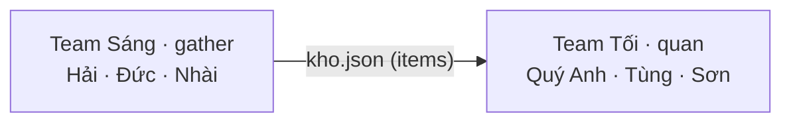

# TEAM

**Tên nhóm:** `SiVuong`  **Số người:** 6  (khớp `team_size` trong `game.contract.json`)

> ⚠️ **Còn thiếu:** cột **GitHub handle** đang để trống — mỗi người tự điền **đúng username GitHub** đã dùng để
> commit (không phải MSSV). `tools/check_team.py` và luật tính commit cần cột này. MSSV ghi kèm trong cột "Thành viên".

## Chia việc SONG SONG — 2 luồng độc lập

Cả nhóm tách thành **2 team làm song song**, chỉ gặp nhau ở **file kho** + hợp đồng chung (đã đóng băng ở
[`docs/contracts/README.md`](../docs/contracts/README.md)):

| Team | Mode | 3 người | Phạm vi |
|---|---|---|---|
| **Team Sáng** | `gather` (lặn & hái) | Hải, Đức, Nhài | `chonoi/sim/gather.py` + UI gather |
| **Team Tối** | `quan` (mở quán) | Quý Anh, Tùng, Sơn | `chonoi/sim/quan.py` + UI quan |

### Bảng thành viên & vai trò

| Thành viên | GitHub handle | Team | Module chính | Vai quy trình | Người dự phòng |
|---|---|---|---|---|---|
| Ngô Ngọc Hải | | Sáng | `sim/gather` | **Integrator** (giữ `docs/contracts/`, gắn tag) · Team lead Sáng | Đức |
| Trần Minh Đức | | Sáng | `sim/gather` | **PO** (đầu mối hỏi giảng viên, giữ `docs/clarify.md`) | Hải |
| Trần Thị Nhài | | Sáng | `client/ui` (gather) | **Scrum/Release** (standup, release) | Hải |
| Bùi Đình Quý Anh (2A202603969) | | Tối | `sim/quan` | **QA lead** · Team lead Tối | Tùng |
| Nguyễn Thanh Tùng (03957) | | Tối | `sim/quan` + `content` | **Content lead** (sáng tạo, `CREDITS.md`) | Sơn |
| Giang Thái Sơn (03964) | | Tối | `client/ui` (quan) + `contracts`/harness AI | **AI/Contracts lead** (`AGENTS.md`, `.agents/skills/`) | Quý Anh |

### Việc của Team Sáng (`gather`)

| Lát | Việc | Người | Deliverable |
|---|---|---|---|
| S1 | Oxy · ngạt/`choke` · Máu/`faint` · biên `d≥0` · giỏ **LIFO** | **Hải** | `chonoi/sim/gather.py` (phần 1) |
| S2 | Hái nút + `regrow` · bắt cá + hồi chiêu · cập bến · **ghi kho** | **Đức** | `chonoi/sim/gather.py` (phần 2) |
| S3 | HUD/UI gather (oxy, giỏ, cá, nút hái) + test gather | **Nhài** | `client/ui`, `tests/test_*gather*` |

### Việc của Team Tối (`quan`)

| Lát | Việc | Người | Deliverable |
|---|---|---|---|
| T1 | Khách theo lịch · giữ chỗ · kiên nhẫn · `customer_left` · `no_dish` | **Quý Anh** | `chonoi/sim/quan.py` (phần 1) |
| T2 | Bếp · bưng · phục vụ · trả tiền · boa · uy tín · `quan_end` | **Tùng** | `chonoi/sim/quan.py` (phần 2) |
| T3 | UI quan (khách/bếp/bàn/tiền) + nạp kho + test quan | **Sơn** | `client/ui`, `tests/test_*quan*` |

### Việc chung & chốt

| Việc | Người | Ghi chú |
|---|---|---|
| Chốt & giữ hợp đồng, gắn tag `phase-1..4` | **Hải** (Integrator) | file sự thật: `docs/contracts/README.md` |
| Hỏi giảng viên, giữ `docs/clarify.md`, mở ADR khi đổi yêu cầu | **Đức** (PO) | |
| Standup giữa phase, cắt Release `v1.0.0`, `CHANGELOG.md` | **Nhài** (Scrum/Release) | |
| Ma trận truy vết + bằng chứng (`docs/verification`, `docs/proof`) | **Quý Anh** (QA lead) | bám mọi phase |
| Sáng tạo (cá/cây/món/bản đồ/âm nhạc) + `CREDITS.md` | **Tùng** | tắt ở headless |
| `AGENTS.md` + ≥ 2 skill/hook nhóm (`.agents/skills/`) | **Sơn** | cập nhật mỗi phase |

## Hợp đồng bàn giao Sáng ↔ Tối (đã chốt)

Điểm giao duy nhất: **file kho** `{"items":{"<kind>":<int≥0>}}`.

- **Sáng ghi** đúng **một lần** khi `gather_end` (`docked`/`fainted`/`time`) qua `--inventory-out`; **không** ghi khi `tick_limit`.
- **Tối đọc** qua `--inventory` → `stock` ban đầu; fallback `scenario.stock`; có **cả hai** ⇒ thoát 2.
- `kind` P1: `ca_loc`, `ca_linh`, `bong_dien_dien`, `bong_sung`.

→ Chi tiết đầy đủ (schema, snapshot, sự kiện, bất biến, change process) ở [`docs/contracts/README.md`](../docs/contracts/README.md).

### Ranh giới file — tránh conflict khi làm song song

- Team Sáng **chỉ** sửa: `chonoi/sim/gather.py` + `client/ui` phần gather + `docs/verification/phase-1.md`.
- Team Tối **chỉ** sửa: `chonoi/sim/quan.py` + `client/ui` phần quan + `docs/verification/phase-2.md`.
- **Dùng chung** (1 người sửa): `chonoi/sim/ramp.py` (Hải) · `chonoi/web/index.html` (Sơn) · `AGENTS.md` (Sơn) · `TEAM.md` (Hải) · `tests/test_smoke_p1.py` đóng băng.
- **Không ai tự sửa** `game.contract.json` / `docs/contracts/` / file khung `chonoi/{runner,inputs,...}.py` — đổi thì báo nhóm + ADR.
- Nhánh ngắn `feat/<phase>-<viec>` → PR vào `main`; **chạy test trước khi push**; Integrator gắn tag.

## Checklist chia việc

### ✅ Team Sáng (`gather`) — tick khi xong

**S1 — Hải (oxy · ngạt · Máu · biên · giỏ)**
- [ ] Bơi + ramp: đổi hướng chạm tốc mục tiêu trong `ramp_max_ticks`; đi chéo không nhanh hơn.
- [ ] Biên `x∈[0,100]`, `d∈[0,30]`, **`d` không âm**; chạm mép ⇒ vận tốc trục đó = 0.
- [ ] Oxy: `d>surface_depth` trừ 1/tick; mặt nước hồi `oxygen_refill_per_tick`; kẹp `[0, oxygen_max_ticks]`.
- [ ] `oxygen_empty` khi xuống 0; đếm `zero_oxy_ticks`; đủ `choke_interval_ticks` ⇒ −1 Máu (`choke`).
- [ ] Máu 0 ⇒ `faint` + `gather_end` reason `fainted`, **giỏ rỗng**.
- [ ] Giỏ **LIFO**, sức chứa `hold_capacity`; `hold_full` khi vượt.

**S2 — Đức (hái · bắt cá · cập bến · kho)**
- [ ] Hái nút `ready` gần nhất (id nhỏ khi bằng) → `node_yield`; `regrow_s` → `node_regrown`.
- [ ] **Cập bến xét TRƯỚC hái** → `gather_end` reason `docked`.
- [ ] `catch` chỉ khi dưới nước & `catch_cd_ticks==0`; `catch_radius`; `fish_yield`; phát `fish_caught`.
- [ ] Ghi kho **đúng 1 lần** khi `gather_end` (`docked/fainted/time`); **KHÔNG** khi `tick_limit`.
- [ ] `fainted` ⇒ ghi `{"items":{}}`; schema/id/số âm sai ⇒ thoát 2.

**S3 — Nhài (UI gather + test)**
- [ ] HUD đọc snapshot gather (oxy, giỏ, cá, nút), **bỏ qua trường chưa có**.
- [ ] Không hard-code số ngoài `game.contract.json`.
- [ ] Thêm test luật gather; `tests/test_smoke_p1.py` **xanh**.

### ✅ Team Tối (`quan`) — tick khi xong

**T1 — Quý Anh (khách · giữ chỗ · kiên nhẫn)**
- [ ] Khách đầu ở `first_customer_tick`, sau đó mỗi `customer_interval_s`.
- [ ] Giữ chỗ: **hai khách cùng bàn ⇒ thoát 2**.
- [ ] Hết `patience_s` chưa phục vụ ⇒ `customer_left` + uy tín `left_reputation_delta`.
- [ ] `no_dish` khi quán không nấu được món khách gọi.

**T2 — Tùng (bếp · phục vụ · tiền · uy tín)**
- [ ] Vòng nấu: `cook_started` → chín sau `cook_s` (`dish_ready`) → `dish_picked` → `served`.
- [ ] `paid` sau `eat_s`; **boa** theo `tip_rate` + `tip_min_patience_ratio` + `tip_reputation`.
- [ ] Uy tín kẹp `[reputation_min, reputation_max]`; `carry_limit`; **không** cháy (`burn_s=null`).
- [ ] `quan_end` khi hết giờ (kèm `money/earned/shift_earned/reputation`).

**T3 — Sơn (UI quan + nạp kho + test)**
- [ ] Nạp `--inventory` → `stock`; fallback `scenario.stock`; **cả hai ⇒ thoát 2**.
- [ ] UI quan đọc snapshot (`stock/hand/stoves/tables/customers`), bỏ qua trường thiếu.
- [ ] Thêm test luật quan; **regression `test_smoke_p1.py` xanh**.

### ✅ Bàn giao Sáng ↔ Tối (2 team cùng tick)

- [ ] `inventory.sample.json` là mẫu hợp lệ cả hai dùng.
- [ ] Chạy thật: sáng `--mode gather --inventory-out kho.json` → tối `--mode quan --inventory kho.json` ra đúng `stock`.
- [ ] Hai bên dùng chung `KINDS_P1`; **không** thêm id nguyên liệu lẻ ở một phía.
- [ ] Cả hai xác nhận §1 + §2 trong [`docs/contracts/README.md`](../docs/contracts/README.md).
- [ ] `inventory.sample.json` khớp `write_inventory` (bỏ mục 0, khóa gốc `items`).

### ✅ Theo phase (mốc tag)

- [ ] **P0:** repo public + collaborator · `TEAM.md` thật · `team_size=6` · `docs/contracts/` chốt · `docs/plan/phase-1.md`.
- [ ] **P1** (tag `phase-1` < 1:00): S1+S2+S3 xong · smoke test xanh · `docs/verification/phase-1.md` + `docs/proof/phase-1/`.
- [ ] **P2** (tag `phase-2` < 1:55): T1+T2+T3 xong · regression P1 xanh · `docs/standup.md` + `docs/retro.md` (mục P2).
- [ ] **P3** (tag `phase-3` < 2:30): tích hợp Sáng→kho→Tối · ADR khi đổi yêu cầu · `AGENTS.md` + ≥ 2 skill.
- [ ] **P4** (tag `phase-4` + Release `v1.0.0` < 3:00): full test · `CHANGELOG.md` · `docs/members/<handle>.md` · `CREDITS.md` · demo.

### ✅ Cá nhân (mỗi người)

- [ ] ≥ **3 commit có nội dung** bằng tài khoản của mình (làm cặp ghi `Co-authored-by:`).
- [ ] Đã điền **GitHub handle** vào bảng trên.
- [ ] Đã ghi ≥ 1 dòng `docs/ai-usage-log.md` (tool/model, việc, token, AI sai ở đâu).
- [ ] Đã viết `docs/members/<handle>.md` (≤ 200 từ, có link commit + lần AI sai).
- [ ] Trước khi push: đã chạy `python -m unittest discover -s tests -v` và để lại kết quả.

## Thỏa thuận làm việc nhóm (điền trong 15 phút kickoff, ≤ 10 dòng)

- **Kênh liên lạc:** Zalo nhóm (chính) + GitHub Issues/PR (việc kỹ thuật).
- **Khi bất đồng về thiết kế:** nói tối đa 2 phút/người; chưa thống nhất thì **Integrator (Hải) quyết** và ghi lý do vào `docs/adr/`.
- **Khi ai trễ / vướng quá 10 phút:** báo ngay trong kênh; **người dự phòng** nhận việc để không chặn luồng.
- **Giờ standup giữa phase:** ngay sau khi gắn tag (mỗi người 1 dòng vào `docs/standup.md`).
- **Cách đọc code của nhau:** mỗi PR cần ≥ 1 người khác review; reviewer bám vào diff, không chỉ "LGTM".
- **Cách dùng Git:** nhánh ngắn `feat/<phase>-<viec>` → PR vào `main`; **Integrator gắn tag**; trước khi push luôn chạy test.
- **Hợp đồng Sáng↔Tối:** hai team xác nhận §1 + §2 trong `docs/contracts/README.md` trước khi code; đổi thì mở ADR.
- **Quy tắc số liệu:** mọi con số đọc từ `game.contract.json`; ngẫu nhiên chỉ qua `Streams` với tên luồng riêng.
- **Bằng chứng:** mỗi việc xong để lại lệnh đã chạy + kết quả (trong PR hoặc `docs/proof/`).
