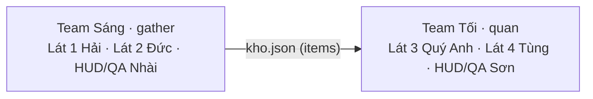

# TEAM

**Tên nhóm:** `<điền tên nhóm>`  **Số người:** 6  (khớp `team_size` trong `game.contract.json`)

> ⚠️ **Còn thiếu:** cột **GitHub handle** đang để trống — mỗi người điền **đúng username GitHub** dùng để commit
> (không phải MSSV). `tools/check_team.py` và luật tính commit cần cột này. MSSV ghi kèm trong cột "Thành viên".

## Tổ chức: 2 team · 4 lát · làm song song

Phase 1 có **4 lát** (PRD-0 §6.2). Nhóm 6 người = **4 lát + 2 người lo HUD/QA/hỗ trợ**, và cần **≥ 2 mục mở rộng**.
Hai team chạy song song, chỉ gặp nhau ở **file kho** (đã đóng băng ở [`docs/contracts/README.md`](../docs/contracts/README.md)).

| Team | Mode | Người | Lát | 
|---|---|---|---|
| **Team Sáng** | `gather` | Hải, Đức, Nhài | Lát 1, 2 + HUD/QA |
| **Team Tối** | `quan` | Quý Anh, Tùng, Sơn | Lát 3, 4 + HUD/QA |



### Bảng thành viên

| Thành viên | GitHub handle | Team | Lát (Phase 1) | Module chính | Vai quy trình |
|---|---|---|---|---|---|
| Ngô Ngọc Hải | | Sáng | **Lát 1** | `sim/gather` | **Integrator** (giữ `docs/contracts/`, gắn tag) · Team lead Sáng |
| Trần Minh Đức | | Sáng | **Lát 2** | `sim/gather` | **PO** (hỏi Anh Năm/giảng viên, giữ `docs/clarify.md`) |
| Trần Thị Nhài | | Sáng | HUD/QA + hỗ trợ | `client/ui` (gather) | **Scrum/Release** (mốc bàn giao, standup, release) |
| Bùi Đình Quý Anh (2A202603969) | | Tối | **Lát 3** | `sim/quan` | **QA lead** (bộ test + ma trận truy vết) · Team lead Tối |
| Nguyễn Thanh Tùng (03957) | | Tối | **Lát 4** | `sim/quan` + `content` | **Content lead** (sáng tạo, `CREDITS.md`) |
| Giang Thái Sơn (03964) | | Tối | HUD/QA + hỗ trợ | `client/ui` (quan) + `contracts` | **AI/Contracts lead** (`AGENTS.md`, `.agents/skills/`) |

---

## Phase 1 — mỗi người cần làm (hạn tag `phase-1` lúc 1:00)

> Quy ước AC: `AC-P1-xx`. Mọi số đọc từ `game.contract.json`, **không hard-code**; ngẫu nhiên chỉ qua
> `Streams(seed)` với **tên luồng riêng**; cùng seed ⇒ JSONL giống từng byte.

### 🐟 Hải — Lát 1: Bơi · oxy · chặn biên · giỏ (`chonoi/sim/gather.py`)

- **Bơi**: tích phân Δt = 1/60 s; vận tốc hội tụ về `speed × move` trong tối đa `ramp_max_ticks` rồi giữ đích; chặn từng thành phần ở biên chữ nhật và **triệt thành phần vận tốc hướng ra ngoài**; `d` không âm.
- **Hướng mặt**: theo `move ≠ 0` gần nhất; đứng yên giữ hướng cuối.
- **Oxy**: mặt nước (`d ≤ surface_depth`) cộng `oxygen_refill_per_tick` mỗi tick, kẹp `[0, oxygen_max_ticks]`, reset ngạt; dưới nước trừ 1/tick, kẹp 0. Phát `oxygen_empty` khi oxy **từ dương xuống 0**.
- **Ngạt**: mỗi bước dưới nước kết thúc với oxy 0 (kể cả bước vừa chạm 0) tăng `zero_oxy_ticks`; đủ `choke_interval_ticks` ⇒ reset đếm, **−1 Máu**, phát `choke`. Chạm oxy 0 ở `t` và ở dưới nước liên tục ⇒ ngạt lần đầu ở `t+59` nếu đếm ban đầu 0; nổi lên **đúng bước đáng ngạt** thì hồi oxy và **không ngạt**.
- **Ngất**: Máu 0 ⇒ bỏ giỏ theo **LIFO**, phát `faint` (`cause:"choke"`, `lost`, `hp:0`) rồi `gather_end` reason `fainted`, kho rỗng, dừng bước.
- **Giỏ**: LIFO, sức chứa `hold_capacity`; đầy ⇒ `hold_full` (`action`, `node_id`/`fish_id`, `required`, `free`).
- **Sự kiện biên**: so đầu/cuối bước để phát `dive` / `surface` (data `pos`), chỉ khi đổi phía biên mặt nước.
- **AC**: `AC-P1-01` (bơi/ramp/biên) · `AC-P1-02` (oxy/`oxygen_empty`) · `AC-P1-03` (ngạt/`choke`/`faint`) · `AC-P1-04` (giỏ LIFO/`hold_full`).
- **Bằng chứng**: test unit luật (ramp, biên, chuỗi ngạt) + `docs/proof/phase-1/`.

### 🐟 Đức — Lát 2: Hái · bắt cá · cập bến · ghi file kho (`chonoi/sim/gather.py`)

- **interact — bến trước**: khoảng cách Euclid tới tâm `dock_pos` **trên `[x,d]`**; trong `dock_radius` ⇒ kết thúc ngay `gather_end` reason `docked`.
- **interact — hái**: ngoài bến, **chỉ khi ở mặt nước**; chọn nút `ready` gần nhất trong `interact_radius`, **hòa theo id**; đủ chỗ ⇒ thêm `node_yield`, đặt `regrow_ticks = regrow_s × 60`, phát `gather` (`node_id`,`kind`,`amount`); thiếu chỗ ⇒ `hold_full`, nút giữ nguyên. Nút từ 1 về 0 phát `node_regrown` và có thể hái ngay.
- **catch**: khi hết hồi và **đang dưới nước** ⇒ chọn đúng **một** đàn gần nhất trong `catch_radius`, hòa theo id; đủ chỗ ⇒ thêm toàn bộ `yield`, xóa đàn, phát `fish_caught` (một event mỗi đàn lấy đủ yield) và đặt cooldown `catch_cooldown_s × 60`; thiếu chỗ ⇒ `hold_full`, **giữ đàn và cooldown, không thử đàn khác**; không có đàn trong tầm ⇒ không event, không hồi chiêu.
- **Hết giờ**: timer ca về 0 ⇒ `gather_end` reason `time` ở mọi độ sâu, **giữ giỏ** sau các hành động trên; chốt kho ngay khi kết thúc và dừng xử lý. E đúng mép bến ở bước cuối vẫn `docked` nếu còn Máu.
- **File kho (§G)**: `{"items":{...}}`, **chỉ khóa `items`**, `kind → số nguyên ≥ 0`, bỏ khóa lượng 0, rỗng = `{"items":{}}`; `--inventory-out` ghi **đúng một lần** (ngất ghi rỗng); chạm `--ticks` trước khi kết thúc buổi sáng ⇒ **không tạo/không đè**; ghi file tạm cùng thư mục rồi **thay thế nguyên tử**; nội dung khớp `inventory` trong event `gather_end`.
- **AC**: `AC-P1-05` (hái/`regrow`/`node_regrown`) · `AC-P1-06` (`docked`) · `AC-P1-07` (catch/cooldown/`fish_caught`) · `AC-P1-08` (ghi kho §G một lần).
- **Bằng chứng**: smoke `gather → kho`; `docs/proof/phase-1/`.

### 🎨 Nhài — HUD gather + QA + hỗ trợ (`client/ui`, `tests/`)

- **HUD buổi sáng**: thời gian, oxy, Máu, giỏ. Client **chỉ đọc snapshot**, bỏ qua trường chưa có.
- **Điều khiển**: WASD/mũi tên bơi, **E** tương tác, **Space** bắt cá.
- **QA hỗ trợ team Sáng**: viết test luật gather; giữ `tests/test_smoke_p1.py` xanh; hỗ trợ lát đang chậm ở phút 20.
- **Scrum/Release**: theo dõi mốc bàn giao, điều phối standup, cắt Release ở Phase 4.
- **AC**: `AC-P1-09` (HUD gather đọc được khi chơi).
- **Bằng chứng**: ảnh/clip HUD + kết quả test.

### 🍜 Quý Anh — Lát 3: Khách · giữ chỗ · kiên nhẫn (`chonoi/sim/quan.py`)

- **Khách theo lịch**: `first_customer_tick`, rồi mỗi `customer_interval_s × 60` tick (chỉ khi còn giờ), tính theo **`phase_tick`** kể cả khi rút ngắn ca. Không còn bàn ⇒ **bỏ lượt**; có bàn ⇒ lấy **bàn trống id nhỏ nhất**.
- **Chọn món**: **đều theo seed** trong 3 món **đủ nguyên liệu khả dụng** (tồn vật lý **trừ phần giữ**); không có món đủ ⇒ phát `no_dish` (`{}` khi có bàn mà thiếu món).
- **Khách mới**: giữ **đúng công thức** ngay, `order_tick = phase_tick` hiện tại, kiên nhẫn đầy, **giảm từ bước sau**; phát `customer_arrived` (`order_id`,`table_id`,`dish_id`).
- **Kiên nhẫn**: về 0 khi còn giờ ⇒ khách rời `customer_left` reason `patience` + uy tín `left_reputation_delta`; nhả phần giữ thô, bỏ món đơn đang nấu/ready/trên tay; nguyên liệu đã dùng **không hoàn lại**.
- **Đơn & trạng thái**: `reserved/assigned/unfulfillable/served`; thiếu `reserved` ở đơn reserved ⇒ cấp theo công thức theo `order_tick` rồi id bàn; khách `waiting` mặc định, `order_status: reserved`. Không món đủ ⇒ `no_dish` + đơn `unfulfillable` (**giữ rỗng, không món**), khách vẫn chờ tới hết kiên nhẫn.
- **AC**: `AC-P1-10` (lịch khách + bàn nhỏ nhất + `no_dish`) · `AC-P1-11` (kiên nhẫn + `customer_left` + uy tín).
- **Vai QA lead**: giữ bộ test + **ma trận truy vết** `docs/verification/phase-1.md`, thu bằng chứng `docs/proof/phase-1/`.
- **Bằng chứng**: test quan + bảng AC→bằng chứng→kết quả.

### 🍜 Tùng — Lát 4: Bếp · bưng · phục vụ · tiền (`chonoi/sim/quan.py`)

- **Tương tác**: di chuyển rồi xét **tối đa một `interact`**, chọn theo **(khoảng cách, bếp trước bàn, id)**; đối tượng chọn không tương tác được ⇒ **bỏ lượt**.
- **Nấu**: bếp `idle` lấy **đơn reserved cũ nhất** (theo `order_tick` rồi id bàn), tiêu **đúng** nguyên liệu giữ, chốt giá, bắt đầu nấu ⇒ `cook_started` (`stove_id`,`order_id`,`dish_id`, thêm `items`,`base_price`). Chỉ tăng `ready_ticks` cho món **đã ready ở đầu bước**; nấu xong ⇒ `ready` với `ready_ticks = 0`, phát `dish_ready`. **`burn_s: null`** — không cháy.
- **Bưng**: bếp `ready` giao món cho **tay trống** và về `idle` ⇒ `dish_picked`.
- **Phục vụ**: bàn nhận đúng `order_id` ⇒ khách ăn với timer đầy ⇒ `served` (`order_id`,`table_id`,`dish_id`,`patience_ticks_left`,`base_price`,`tip`). **Phục vụ đúng tick kiên nhẫn về 0 hoặc hết ca vẫn hợp lệ.** Chốt boa `floor(tiền món × tip_rate)` nếu tỷ lệ kiên nhẫn còn lại **sau bước 1** đạt `tip_min_patience_ratio`, thấp hơn ⇒ boa 0.
- **Trả tiền**: ăn xong trả tiền rồi rời bàn ngay ⇒ `paid` (`base_price` tiền món trước boa, `tip`, `amount`, reason `finished_eating`/`closing`). Boa dương cộng `tip_reputation` khi thu tiền, **kẹp uy tín** theo tuning.
- **Hết ca**: khách còn ăn **trả ngay** (kể cả vừa được giao món), khách còn chờ rời reason `closing` **không trừ uy tín**; dọn xong phát `quan_end` (`reason:"time"`, `money`, `earned`, `shift_earned`, `reputation`).
- **AC**: `AC-P1-12` (bếp nấu + `ready_ticks`) · `AC-P1-13` (bưng + phục vụ + boa) · `AC-P1-14` (`paid` + ăn cuối ca + `quan_end`).
- **Vai Content lead**: đề xuất & ghi mục mở rộng vào `CREDITS.md`/README.

### 🎨 Sơn — HUD quan + nạp kho + hợp đồng/harness (`client/ui`, `docs/contracts`, `AGENTS.md`)

- **HUD buổi tối**: kho khả dụng, món gọi, kiên nhẫn, trạng thái bếp, món trên tay, tiền, uy tín. Client chỉ đọc snapshot.
- **Nạp kho**: `--inventory` → `stock`; thiếu cả `inventory` và `scenario.quan.stock` ⇒ kho rỗng; khai **cả hai** ⇒ thoát 2; sai schema/kind lạ/ngoài miền ⇒ thoát 2.
- **Giữ hợp đồng** + `AGENTS.md` + viết **≥ 2 skill/hook nhóm** ở `.agents/skills/`.
- **AC**: `AC-P1-15` (HUD quan + nạp kho).
- **Bằng chứng**: ảnh/clip HUD quan + smoke `gather → kho → quan`.

---

## Mốc & lịch Phase 1 (60 phút)

| Phút | Việc | Ai chủ trì |
|---|---|---|
| 0–15 | Vào fork, chia vai, ghi `TEAM.md`, **chốt hợp đồng kho §G**, bắt đầu 4 lát song song | cả nhóm (Hải/Đức điều phối) |
| 15–45 | Build & phối hợp các lát; **rá Soát hỗ trợ ở phút 20**; thử **xuất file kho thật trước phút 25**; standup 2–3 phút | Nhài (mốc) · Quý Anh (QA) |
| 45–55 | Chạy smoke **hai tiến trình** + chơi thử trên `main`; hoàn thiện ma trận truy vết; **gắn tag** | Quý Anh · Hải (tag) |
| 55–60 | Dự phòng; đẩy `phase-1` **chậm nhất 1:00** | Hải |

**Smoke bàn giao (bắt buộc):**
```bash
<headless_cmd> --mode gather --seed 42 --scenario dock.json --inputs dock-inputs.json --ticks 1 --out gather.jsonl --inventory-out catch.json
<headless_cmd> --mode quan   --seed 42 --inventory catch.json --ticks 0 --out quan.jsonl
# dock.json = {"gather":{"hold":["ca_loc","bong_sung","bong_sung"]}} ; dock-inputs.json = {"frames":[{"tick":0,"interact":true}]}
# snapshot quan tick 0 phải có stock {"bong_sung":2,"ca_loc":1}
```

## Định nghĩa hoàn thành Phase 1 (DoD · PRD §7)

- [ ] Chơi được **cả hai buổi** đúng phạm vi lõi; HUD đọc được trong lúc chơi.
- [ ] `game.contract.json` khớp bản chạy, đầy đủ **Test Contract v1.0**.
- [ ] Smoke hai tiến trình trên `main` cho thấy quán nhận **đúng file kho**.
- [ ] README ghi cách chạy từ clone sạch ≤ 3 lệnh (macOS/Linux), điều khiển, cách tính điểm, lệnh test; test chạy **1 lệnh**.
- [ ] Fork có đủ collaborator; commit gắn tài khoản từng người; `TEAM.md` + `team_size` khớp.
- [ ] Hợp đồng kho có schema + ví dụ hợp lệ (`docs/contracts/`, `inventory.sample.json`).
- [ ] `docs/verification/phase-1.md` + bằng chứng ở commit gắn tag; `docs/clarify.md`, `docs/ai-usage-log.md`, `docs/retro.md`, `docs/members/<handle>.md`.
- [ ] Mục **"Sáng tạo của nhóm"** (nếu có) kèm bằng chứng lõi vẫn đúng.
- [ ] **Tag `phase-1`** trỏ commit bàn giao trên `main`, **chậm nhất 1:00**.

## Mở rộng (nhóm 6 người cần ≥ 2 mục · PRD §2)

Chỉ **sau khi lõi đúng**. Phần tự thêm phải **tắt ở headless** hoặc không đổi tick/sự kiện/tiền/uy tín/snapshot.
- [ ] **MR-1 (Tùng):** 1–2 món/sinh vật/cơ chế nhỏ (ví dụ cá bơi nhẹ khi `random_fish=true`) — có cờ tắt cho headless.
- [ ] **MR-2 (Nhài):** đồ họa/âm thanh/HUD mở rộng theo phong cách §3 (áo bà ba, khăn rằn, đèn dây) — chỉ ở client.
- [ ] Ghi vào README "Sáng tạo của nhóm" + nguồn asset ở `CREDITS.md`.

---

## Hợp đồng bàn giao Sáng ↔ Tối (đã chốt)

Điểm giao duy nhất: **file kho** `{"items":{"<kind>":<int≥0>}}` (§G). Sáng ghi một lần khi `gather_end`
(`docked/fainted/time`), **không** ghi khi `tick_limit`; Tối đọc qua `--inventory` → `stock` (fallback `scenario.stock`,
cả hai ⇒ thoát 2). Chi tiết đầy đủ + checklist ở [`docs/contracts/README.md`](../docs/contracts/README.md).

### Ranh giới file — tránh conflict khi làm song song

- Team Sáng **chỉ** sửa: `chonoi/sim/gather.py`, `client/ui` phần gather, `tests/test_*gather*`, `docs/verification/phase-1.md`.
- Team Tối **chỉ** sửa: `chonoi/sim/quan.py`, `client/ui` phần quan, `tests/test_*quan*`, `docs/verification/phase-2.md`.
- **Dùng chung (1 người sửa):** `chonoi/sim/ramp.py` (Hải) · `chonoi/web/index.html` (Sơn) · `AGENTS.md` (Sơn) · `TEAM.md` (Hải) · `tests/test_smoke_p1.py` đóng băng.
- **Không ai tự sửa** `game.contract.json` / `docs/contracts/` / file khung `chonoi/{runner,inputs,scenario,inventory,ids,rng,jsonl,contract}.py` — đổi thì báo nhóm + ADR.
- Nhánh ngắn `feat/<phase>-<viec>` → PR vào `main`; chạy test trước khi push; Integrator gắn tag.

## Checklist nhanh (tick khi xong)

- [ ] **Hải** — Lát 1 xong (`AC-P1-01..04`).
- [ ] **Đức** — Lát 2 xong (`AC-P1-05..08`).
- [ ] **Nhài** — HUD gather (`AC-P1-09`) + hỗ trợ QA.
- [ ] **Quý Anh** — Lát 3 xong (`AC-P1-10..11`) + ma trận truy vết.
- [ ] **Tùng** — Lát 4 xong (`AC-P1-12..14`) + mục mở rộng MR-1.
- [ ] **Sơn** — HUD quan + nạp kho (`AC-P1-15`) + `AGENTS.md`/skills.
- [ ] Bàn giao: smoke 2 tiến trình ra đúng `stock`.
- [ ] Tag `phase-1` < 1:00 + `docs/verification/phase-1.md` + `docs/proof/phase-1/`.

## Thỏa thuận làm việc nhóm

- **Kênh liên lạc:** Zalo nhóm (chính) + GitHub Issues/PR (việc kỹ thuật).
- **Bất đồng thiết kế:** nói tối đa 2 phút/người; chưa thống nhất thì **Integrator (Hải) quyết** và ghi `docs/adr/`.
- **Ai trễ / vướng quá 10 phút:** báo ngay trong kênh; **người dự phòng** (Hải↔Đức, Quý Anh↔Tùng) nhận việc.
- **Standup:** 2–3 phút ngay sau mốc phase (đã xong / sắp làm / đang vướng) → `docs/standup.md`.
- **Đọc code của nhau:** mỗi PR ≥ 1 reviewer bám diff, không chỉ "LGTM"; review chéo giữa các lát.
- **Git:** nhánh `feat/<phase>-<viec>` → PR `main`; **Integrator gắn tag**; chạy test trước khi push.
- **Hợp đồng kho:** hai team xác nhận §1 trong `docs/contracts/README.md` trước khi code; đổi ⇒ mở ADR.
- **Số liệu:** chỉ đọc từ `game.contract.json`; ngẫu nhiên chỉ qua `Streams` (tên luồng riêng); không hard-code.
- **Bằng chứng:** mỗi việc xong để lại lệnh đã chạy + kết quả (PR hoặc `docs/proof/`).
