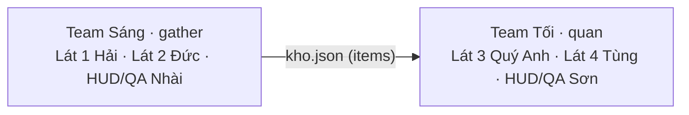

# TEAM

**Tên nhóm:** `<điền tên nhóm>`  **Số người:** 6  (khớp `team_size` trong `game.contract.json`)

> ⚠️ **Còn thiếu:** cột **GitHub handle** đang để trống — mỗi người điền **đúng username GitHub** dùng để commit
> (không phải MSSV). `tools/check_team.py` và luật tính commit cần cột này. MSSV ghi kèm trong cột "Thành viên".

## Tổ chức: 2 team · 4 lát · làm song song

Phase 1 có **4 lát** (PRD-0 §6.2). Nhóm 6 người = **4 lát + 2 người lo HUD/QA/hỗ trợ**, và cần **≥ 2 mục mở rộng**.
Hai team chạy song song, chỉ gặp nhau ở **file kho** (đã đóng băng ở [`docs/contracts/README.md`](../docs/contracts/README.md)).

| Team | Mode | Người | Lát | 
|---|---|---|---|
| **Team Sáng** | `gather` | Hải, Đức, Nhài | Lát 1, 2 + HUD/QA |
| **Team Tối** | `quan` | Quý Anh, Tùng, Sơn | Lát 3, 4 + HUD/QA |



### Bảng thành viên

| Thành viên | GitHub handle | Team | Lát (Phase 1) | Module chính | Vai quy trình |
|---|---|---|---|---|---|
| Ngô Ngọc Hải | NgoHai0804 | Sáng | **Lát 1** | `sim/gather` | **Integrator** (giữ `docs/contracts/`, gắn tag) · Team lead Sáng |
| Trần Minh Đức | tmduc23 | Sáng | **Lát 2** | `sim/gather` | **PO** (hỏi Anh Năm/giảng viên, giữ `docs/clarify.md`) |
| Trần Thị Nhài | | Sáng | HUD/QA + hỗ trợ | `client/ui` (gather) | **Scrum/Release** (mốc bàn giao, standup, release) |
| Bùi Đình Quý Anh (2A202603969) | | Tối | **Lát 3** | `sim/quan` | **QA lead** (bộ test + ma trận truy vết) · Team lead Tối |
| Nguyễn Thanh Tùng (03957) | | Tối | **Lát 4** | `sim/quan` + `content` | **Content lead** (sáng tạo, `CREDITS.md`) |
| Giang Thái Sơn (03964) | | Tối | HUD/QA + hỗ trợ | `client/ui` (quan) + `contracts` | **AI/Contracts lead** (`AGENTS.md`, `.agents/skills/`) |

---

## Phase 1 — mỗi người cần làm (hạn tag `phase-1` lúc 1:00)

> Quy ước AC: `AC-P1-xx`. Mọi số đọc từ `game.contract.json`, **không hard-code**; ngẫu nhiên chỉ qua
> `Streams(seed)` với **tên luồng riêng**; cùng seed ⇒ JSONL giống từng byte.

### 🐟 Hải — Lát 1: Bơi · oxy · chặn biên · giỏ (`chonoi/sim/gather.py`)

- **Bơi**: tích phân Δt = 1/60 s; vận tốc hội tụ về `speed × move` trong tối đa `ramp_max_ticks` rồi giữ đích; chặn từng thành phần ở biên chữ nhật và **triệt thành phần vận tốc hướng ra ngoài**; `d` không âm.
- **Hướng mặt**: theo `move ≠ 0` gần nhất; đứng yên giữ hướng cuối.
- **Oxy**: mặt nước (`d ≤ surface_depth`) cộng `oxygen_refill_per_tick` mỗi tick, kẹp `[0, oxygen_max_ticks]`, reset ngạt; dưới nước trừ 1/tick, kẹp 0. Phát `oxygen_empty` khi oxy **từ dương xuống 0**.
- **Ngạt**: mỗi bước dưới nước kết thúc với oxy 0 (kể cả bước vừa chạm 0) tăng `zero_oxy_ticks`; đủ `choke_interval_ticks` ⇒ reset đếm, **−1 Máu**, phát `choke`. Chạm oxy 0 ở `t` và ở dưới nước liên tục ⇒ ngạt lần đầu ở `t+59` nếu đếm ban đầu 0; nổi lên **đúng bước đáng ngạt** thì hồi oxy và **không ngạt**.
- **Ngất**: Máu 0 ⇒ bỏ giỏ theo **LIFO**, phát `faint` (`cause:"choke"`, `lost`, `hp:0`) rồi `gather_end` reason `fainted`, kho rỗng, dừng bước.
- **Giỏ**: LIFO, sức chứa `hold_capacity`; đầy ⇒ `hold_full` (`action`, `node_id`/`fish_id`, `required`, `free`).
- **Sự kiện biên**: so đầu/cuối bước để phát `dive` / `surface` (data `pos`), chỉ khi đổi phía biên mặt nước.
- **AC**: `AC-P1-01` (bơi/ramp/biên) · `AC-P1-02` (oxy/`oxygen_empty`) · `AC-P1-03` (ngạt/`choke`/`faint`) · `AC-P1-04` (giỏ LIFO/`hold_full`).
- **Bằng chứng**: test unit luật (ramp, biên, chuỗi ngạt) + `docs/proof/phase-1/`.

### 🐟 Đức — Lát 2: Hái · bắt cá · cập bến · ghi file kho (`chonoi/sim/gather.py`)

- **interact — bến trước**: khoảng cách Euclid tới tâm `dock_pos` **trên `[x,d]`**; trong `dock_radius` ⇒ kết thúc ngay `gather_end` reason `docked`.
- **interact — hái**: ngoài bến, **chỉ khi ở mặt nước**; chọn nút `ready` gần nhất trong `interact_radius`, **hòa theo id**; đủ chỗ ⇒ thêm `node_yield`, đặt `regrow_ticks = regrow_s × 60`, phát `gather` (`node_id`,`kind`,`amount`); thiếu chỗ ⇒ `hold_full`, nút giữ nguyên. Nút từ 1 về 0 phát `node_regrown` và có thể hái ngay.
- **catch**: khi hết hồi và **đang dưới nước** ⇒ chọn đúng **một** đàn gần nhất trong `catch_radius`, hòa theo id; đủ chỗ ⇒ thêm toàn bộ `yield`, xóa đàn, phát `fish_caught` (một event mỗi đàn lấy đủ yield) và đặt cooldown `catch_cooldown_s × 60`; thiếu chỗ ⇒ `hold_full`, **giữ đàn và cooldown, không thử đàn khác**; không có đàn trong tầm ⇒ không event, không hồi chiêu.
- **Hết giờ**: timer ca về 0 ⇒ `gather_end` reason `time` ở mọi độ sâu, **giữ giỏ** sau các hành động trên; chốt kho ngay khi kết thúc và dừng xử lý. E đúng mép bến ở bước cuối vẫn `docked` nếu còn Máu.
- **File kho (§G)**: `{"items":{...}}`, **chỉ khóa `items`**, `kind → số nguyên ≥ 0`, bỏ khóa lượng 0, rỗng = `{"items":{}}`; `--inventory-out` ghi **đúng một lần** (ngất ghi rỗng); chạm `--ticks` trước khi kết thúc buổi sáng ⇒ **không tạo/không đè**; ghi file tạm cùng thư mục rồi **thay thế nguyên tử**; nội dung khớp `inventory` trong event `gather_end`.
- **AC**: `AC-P1-05` (hái/`regrow`/`node_regrown`) · `AC-P1-06` (`docked`) · `AC-P1-07` (catch/cooldown/`fish_caught`) · `AC-P1-08` (ghi kho §G một lần).
- **Bằng chứng**: smoke `gather → kho`; `docs/proof/phase-1/`.

### 🎨 Nhài — HUD gather + QA + hỗ trợ (`client/ui`, `tests/`)

- **HUD buổi sáng**: thời gian, oxy, Máu, giỏ. Client **chỉ đọc snapshot**, bỏ qua trường chưa có.
- **Điều khiển**: WASD/mũi tên bơi, **E** tương tác, **Space** bắt cá.
- **QA hỗ trợ team Sáng**: viết test luật gather; giữ `tests/test_smoke_p1.py` xanh; hỗ trợ lát đang chậm ở phút 20.
- **Scrum/Release**: theo dõi mốc bàn giao, điều phối standup, cắt Release ở Phase 4.
- **AC**: `AC-P1-09` (HUD gather đọc được khi chơi).
- **Bằng chứng**: ảnh/clip HUD + kết quả test.

### 🍜 Quý Anh — Lát 3: Khách · giữ chỗ · kiên nhẫn (`chonoi/sim/quan.py`)

- **Khách theo lịch**: `first_customer_tick`, rồi mỗi `customer_interval_s × 60` tick (chỉ khi còn giờ), tính theo **`phase_tick`** kể cả khi rút ngắn ca. Không còn bàn ⇒ **bỏ lượt**; có bàn ⇒ lấy **bàn trống id nhỏ nhất**.
- **Chọn món**: **đều theo seed** trong 3 món **đủ nguyên liệu khả dụng** (tồn vật lý **trừ phần giữ**); không có món đủ ⇒ phát `no_dish` (`{}` khi có bàn mà thiếu món).
- **Khách mới**: giữ **đúng công thức** ngay, `order_tick = phase_tick` hiện tại, kiên nhẫn đầy, **giảm từ bước sau**; phát `customer_arrived` (`order_id`,`table_id`,`dish_id`).
- **Kiên nhẫn**: về 0 khi còn giờ ⇒ khách rời `customer_left` reason `patience` + uy tín `left_reputation_delta`; nhả phần giữ thô, bỏ món đơn đang nấu/ready/trên tay; nguyên liệu đã dùng **không hoàn lại**.
- **Đơn & trạng thái**: `reserved/assigned/unfulfillable/served`; thiếu `reserved` ở đơn reserved ⇒ cấp theo công thức theo `order_tick` rồi id bàn; khách `waiting` mặc định, `order_status: reserved`. Không món đủ ⇒ `no_dish` + đơn `unfulfillable` (**giữ rỗng, không món**), khách vẫn chờ tới hết kiên nhẫn.
- **AC**: `AC-P1-10` (lịch khách + bàn nhỏ nhất + `no_dish`) · `AC-P1-11` (kiên nhẫn + `customer_left` + uy tín).
- **Vai QA lead**: giữ bộ test + **ma trận truy vết** `docs/verification/phase-1.md`, thu bằng chứng `docs/proof/phase-1/`.
- **Bằng chứng**: test quan + bảng AC→bằng chứng→kết quả.

### 🍜 Tùng — Lát 4: Bếp · bưng · phục vụ · tiền (`chonoi/sim/quan.py`)

- **Tương tác**: di chuyển rồi xét **tối đa một `interact`**, chọn theo **(khoảng cách, bếp trước bàn, id)**; đối tượng chọn không tương tác được ⇒ **bỏ lượt**.
- **Nấu**: bếp `idle` lấy **đơn reserved cũ nhất** (theo `order_tick` rồi id bàn), tiêu **đúng** nguyên liệu giữ, chốt giá, bắt đầu nấu ⇒ `cook_started` (`stove_id`,`order_id`,`dish_id`, thêm `items`,`base_price`). Chỉ tăng `ready_ticks` cho món **đã ready ở đầu bước**; nấu xong ⇒ `ready` với `ready_ticks = 0`, phát `dish_ready`. **`burn_s: null`** — không cháy.
- **Bưng**: bếp `ready` giao món cho **tay trống** và về `idle` ⇒ `dish_picked`.
- **Phục vụ**: bàn nhận đúng `order_id` ⇒ khách ăn với timer đầy ⇒ `served` (`order_id`,`table_id`,`dish_id`,`patience_ticks_left`,`base_price`,`tip`). **Phục vụ đúng tick kiên nhẫn về 0 hoặc hết ca vẫn hợp lệ.** Chốt boa `floor(tiền món × tip_rate)` nếu tỷ lệ kiên nhẫn còn lại **sau bước 1** đạt `tip_min_patience_ratio`, thấp hơn ⇒ boa 0.
- **Trả tiền**: ăn xong trả tiền rồi rời bàn ngay ⇒ `paid` (`base_price` tiền món trước boa, `tip`, `amount`, reason `finished_eating`/`closing`). Boa dương cộng `tip_reputation` khi thu tiền, **kẹp uy tín** theo tuning.
- **Hết ca**: khách còn ăn **trả ngay** (kể cả vừa được giao món), khách còn chờ rời reason `closing` **không trừ uy tín**; dọn xong phát `quan_end` (`reason:"time"`, `money`, `earned`, `shift_earned`, `reputation`).
- **AC**: `AC-P1-12` (bếp nấu + `ready_ticks`) · `AC-P1-13` (bưng + phục vụ + boa) · `AC-P1-14` (`paid` + ăn cuối ca + `quan_end`).
- **Vai Content lead**: đề xuất & ghi mục mở rộng vào `CREDITS.md`/README.

### 🎨 Sơn — HUD quan + nạp kho + hợp đồng/harness (`client/ui`, `docs/contracts`, `AGENTS.md`)

- **HUD buổi tối**: kho khả dụng, món gọi, kiên nhẫn, trạng thái bếp, món trên tay, tiền, uy tín. Client chỉ đọc snapshot.
- **Nạp kho**: `--inventory` → `stock`; thiếu cả `inventory` và `scenario.quan.stock` ⇒ kho rỗng; khai **cả hai** ⇒ thoát 2; sai schema/kind lạ/ngoài miền ⇒ thoát 2.
- **Giữ hợp đồng** + `AGENTS.md` + viết **≥ 2 skill/hook nhóm** ở `.agents/skills/`.
- **AC**: `AC-P1-15` (HUD quan + nạp kho).
- **Bằng chứng**: ảnh/clip HUD quan + smoke `gather → kho → quan`.

---

## Mốc & lịch Phase 1 (60 phút)

| Phút | Việc | Ai chủ trì |
|---|---|---|
| 0–15 | Vào fork, chia vai, ghi `TEAM.md`, **chốt hợp đồng kho §G**, bắt đầu 4 lát song song | cả nhóm (Hải/Đức điều phối) |
| 15–45 | Build & phối hợp các lát; **rá Soát hỗ trợ ở phút 20**; thử **xuất file kho thật trước phút 25**; standup 2–3 phút | Nhài (mốc) · Quý Anh (QA) |
| 45–55 | Chạy smoke **hai tiến trình** + chơi thử trên `main`; hoàn thiện ma trận truy vết; **gắn tag** | Quý Anh · Hải (tag) |
| 55–60 | Dự phòng; đẩy `phase-1` **chậm nhất 1:00** | Hải |

**Smoke bàn giao (bắt buộc):**
```bash
<headless_cmd> --mode gather --seed 42 --scenario dock.json --inputs dock-inputs.json --ticks 1 --out gather.jsonl --inventory-out catch.json
<headless_cmd> --mode quan   --seed 42 --inventory catch.json --ticks 0 --out quan.jsonl
# dock.json = {"gather":{"hold":["ca_loc","bong_sung","bong_sung"]}} ; dock-inputs.json = {"frames":[{"tick":0,"interact":true}]}
# snapshot quan tick 0 phải có stock {"bong_sung":2,"ca_loc":1}
```

## Định nghĩa hoàn thành Phase 1 (DoD · PRD §7)

- [ ] Chơi được **cả hai buổi** đúng phạm vi lõi; HUD đọc được trong lúc chơi.
- [ ] `game.contract.json` khớp bản chạy, đầy đủ **Test Contract v1.0**.
- [ ] Smoke hai tiến trình trên `main` cho thấy quán nhận **đúng file kho**.
- [ ] README ghi cách chạy từ clone sạch ≤ 3 lệnh (macOS/Linux), điều khiển, cách tính điểm, lệnh test; test chạy **1 lệnh**.
- [ ] Fork có đủ collaborator; commit gắn tài khoản từng người; `TEAM.md` + `team_size` khớp.
- [ ] Hợp đồng kho có schema + ví dụ hợp lệ (`docs/contracts/`, `inventory.sample.json`).
- [ ] `docs/verification/phase-1.md` + bằng chứng ở commit gắn tag; `docs/clarify.md`, `docs/ai-usage-log.md`, `docs/retro.md`, `docs/members/<handle>.md`.
- [ ] Mục **"Sáng tạo của nhóm"** (nếu có) kèm bằng chứng lõi vẫn đúng.
- [ ] **Tag `phase-1`** trỏ commit bàn giao trên `main`, **chậm nhất 1:00**.

## Mở rộng (nhóm 6 người cần ≥ 2 mục · PRD §2)

Chỉ **sau khi lõi đúng**. Phần tự thêm phải **tắt ở headless** hoặc không đổi tick/sự kiện/tiền/uy tín/snapshot.
- [ ] **MR-1 (Tùng):** 1–2 món/sinh vật/cơ chế nhỏ (ví dụ cá bơi nhẹ khi `random_fish=true`) — có cờ tắt cho headless.
- [ ] **MR-2 (Nhài):** đồ họa/âm thanh/HUD mở rộng theo phong cách §3 (áo bà ba, khăn rằn, đèn dây) — chỉ ở client.
- [ ] Ghi vào README "Sáng tạo của nhóm" + nguồn asset ở `CREDITS.md`.

---

## Hợp đồng bàn giao Sáng ↔ Tối (đã chốt)

Điểm giao duy nhất: **file kho** `{"items":{"<kind>":<int≥0>}}` (§G). Sáng ghi một lần khi `gather_end`
(`docked/fainted/time`), **không** ghi khi `tick_limit`; Tối đọc qua `--inventory` → `stock` (fallback `scenario.stock`,
cả hai ⇒ thoát 2). Chi tiết đầy đủ + checklist ở [`docs/contracts/README.md`](../docs/contracts/README.md).

### Ranh giới file — tránh conflict khi làm song song

- Team Sáng **chỉ** sửa: `chonoi/sim/gather.py`, `client/ui` phần gather, `tests/test_*gather*`, `docs/verification/phase-1.md`.
- Team Tối **chỉ** sửa: `chonoi/sim/quan.py`, `client/ui` phần quan, `tests/test_*quan*`, `docs/verification/phase-2.md`.
- **Dùng chung (1 người sửa):** `chonoi/sim/ramp.py` (Hải) · `chonoi/web/index.html` (Sơn) · `AGENTS.md` (Sơn) · `TEAM.md` (Hải) · `tests/test_smoke_p1.py` đóng băng.
- **Không ai tự sửa** `game.contract.json` / `docs/contracts/` / file khung `chonoi/{runner,inputs,scenario,inventory,ids,rng,jsonl,contract}.py` — đổi thì báo nhóm + ADR.
- Nhánh ngắn `feat/<phase>-<viec>` → PR vào `main`; chạy test trước khi push; Integrator gắn tag.

## Checklist nhanh (tick khi xong)

- [ ] **Hải** — Lát 1 xong (`AC-P1-01..04`).
- [ ] **Đức** — Lát 2 xong (`AC-P1-05..08`).
- [ ] **Nhài** — HUD gather (`AC-P1-09`) + hỗ trợ QA.
- [ ] **Quý Anh** — Lát 3 xong (`AC-P1-10..11`) + ma trận truy vết.
- [ ] **Tùng** — Lát 4 xong (`AC-P1-12..14`) + mục mở rộng MR-1.
- [ ] **Sơn** — HUD quan + nạp kho (`AC-P1-15`) + `AGENTS.md`/skills.
- [ ] Bàn giao: smoke 2 tiến trình ra đúng `stock`.
- [ ] Tag `phase-1` < 1:00 + `docs/verification/phase-1.md` + `docs/proof/phase-1/`.

## Thỏa thuận làm việc nhóm

- **Kênh liên lạc:** Zalo nhóm (chính) + GitHub Issues/PR (việc kỹ thuật).
- **Bất đồng thiết kế:** nói tối đa 2 phút/người; chưa thống nhất thì **Integrator (Hải) quyết** và ghi `docs/adr/`.
- **Ai trễ / vướng quá 10 phút:** báo ngay trong kênh; **người dự phòng** (Hải↔Đức, Quý Anh↔Tùng) nhận việc.
- **Standup:** 2–3 phút ngay sau mốc phase (đã xong / sắp làm / đang vướng) → `docs/standup.md`.
- **Đọc code của nhau:** mỗi PR ≥ 1 reviewer bám diff, không chỉ "LGTM"; review chéo giữa các lát.
- **Git:** nhánh `feat/<phase>-<viec>` → PR `main`; **Integrator gắn tag**; chạy test trước khi push.
- **Hợp đồng kho:** hai team xác nhận §1 trong `docs/contracts/README.md` trước khi code; đổi ⇒ mở ADR.
- **Số liệu:** chỉ đọc từ `game.contract.json`; ngẫu nhiên chỉ qua `Streams` (tên luồng riêng); không hard-code.
- **Bằng chứng:** mỗi việc xong để lại lệnh đã chạy + kết quả (PR hoặc `docs/proof/`).

---

# Phase 2 — Một ngày ở chợ nổi (hạn tag `phase-2` lúc 1:55)

> Ticket: TICKET-02 · Contract **v1.1** · 55 phút (1:00–1:55). Hai buổi đã nối được; nay chơi trọn **một vòng ngày**:
> sáng Út Sen xem thực đơn để biết cần tìm gì → tối quán dùng phần mang về → cuối ngày mua nâng cấp cho lần lặn sau.
> Quy ước AC: `AC-P2-xx`. Đọc số từ `game.contract.json` v1.1, **không hard-code**; ngẫu nhiên chỉ qua `Streams(seed)`;
> cùng seed ⇒ JSONL giống từng byte. **Làm lõi trước, mở rộng sau.**

## Lõi — số liệu chuẩn (ticket §1.1–1.3, §2)

### Buổi sáng — Lặn & hái
- **Thời lượng** 180 s (10.800 tick). **Vùng nước** `x∈[0,100]`, `d∈[0,30]`, chặn ở mép; mặt nước `d≤0.5`; nông `d<10`, giữa `10≤d<20`, sâu `d≥20`.
- **Bến/xuất phát** tâm `[2,0]` r=3 m, xuất phát `[2,0]` hướng 0° (+x). **Bơi** 4.0 m/s, đạt tốc độ hoặc dừng ≤ 0.1 s (6 tick).
- **Oxy & ngạt**: cơ sở 30 s (1.800 tick); dưới nước −1/tick, mặt nước +6/tick, kẹp max. Dưới nước oxy 0 ⇒ −1 Máu mỗi 60 tick (**kể cả bước vừa chạm 0**), reset nhịp khi oxy >0 hoặc lên mặt. Ngạt **xuyên bất tử, không rơi hàng**.
- **Giỏ & hái**: 12 ô, mỗi nguyên liệu 1 ô; hái ở mặt nước ≤ 2.0 m, lấy 1, mọc lại 20 s (1.200 tick); **xét bến trước nút hái**. Nút: bông điên điển N1[12,0], N2[28,0] · bông súng N3[44,0], N4[60,0] · **kèo nèo N5[76,0], N6[90,0]**.
- **Bắt cá** `catch` (Space), chỉ dưới nước, đàn gần nhất ≤ 2.0 m **hòa theo id**, cần đủ chỗ cho **cả đàn**, hồi 0.5 s (30 tick) từ lần bắt thành công. Yield: linh 3, lóc 1, **kèo 2**.
- **Đàn cá bơi**: 1.5 m/s trong `x∈[4,96]`; linh `d∈[3,12]`, lóc `[8,20]`, kèo `[22,28]`. Đổi hướng theo seed ở bước bơi thứ **120, 240…** *trước khi di chuyển*. Tới mép thì phản xạ phần quãng đường còn lại và đảo thành phần hướng **vuông góc** với mép; chạm góc đảo cả hai.
- **Điểm sinh**: `x∈{15,30,45,60,75,90}`; linh `d∈{5,10}`, lóc `{10,16}`, kèo `{24,27}` (36 cặp loài–vị trí, **30 vị trí hình học**). Đầu ca **8 đàn** ở 8 điểm khác nhau, trần **12 đàn**. Tại `phase_tick = 360·k` (k≥1), *sau khi cá bơi*, sinh tối đa 1 đàn nếu còn dưới trần và có điểm cách mọi đàn đang sống > 1 m; bỏ lượt nếu hết điểm. Loài chọn theo trọng số linh **40%** / lóc **30%** / kèo **30%** (chuẩn hóa lại theo loài còn điểm hợp lệ), rồi chọn đều một điểm của loài và lấy hướng ban đầu theo seed. **Cá mới tham gia từ bước sau.**
- **Kết thúc**: `docked` (tương tác trong bán kính bến), `time` (hết giờ ở bất kỳ độ sâu nào) — cả hai **giữ giỏ**; `fainted` (Máu 0) — **mất toàn bộ giỏ**.

### Cá Sấu Năm Chèo, Máu và ngất
- Máu cơ sở **3**, hồi đầy đầu mỗi Ngày. Cá Sấu ở `d∈[10,30]`: **M1** tuần tra `[60,24]→[64,24]`; **M2** từ **Ngày 3**, `[85,18]→[89,18]`. Waypoint đầu = vị trí xuất phát; trong gather độc lập dùng bố trí Ngày 1.
- `patrol` 1.0 m/s tới waypoint, đổi sang mục tiêu kia cho bước sau khi đến. Người chơi `d≥10` và cách ≤ 10 m ⇒ chuyển `chase`, bơi 3.0 m/s; về `patrol` khi cách > 16 m hoặc người chơi lên `d<10`. Chặn theo biên map + dải độ sâu của loài.
- Sau khi **cả hai** di chuyển: cách ≤ 1.5 m, người chơi `d≥10`, hết bất tử ⇒ chạm −1 Máu, bỏ `floor(đang mang/2)` theo **LIFO** (nhặt sau mất trước), đặt bất tử **90 tick**. Tối đa **1 hit/bước**, chọn con gần nhất, hòa theo id. Trong bất tử không phát hit, không chuyển sang recoil do chạm.
- Con gây hit vào `recoil` **60 bước** (từ bước sau), lùi theo hướng xa người chơi **đã chốt lúc chạm** (trùng tâm dùng +x), mỗi bước **2/60 m** trước chặn mép và **không gây hit**. Hết recoil về `patrol`. Máu chạm 0 ⇒ **ngất ngay**, vẫn mở quán tối với kho bàn giao **rỗng**.

### Buổi tối — Mở quán
- 180 s. Phòng `x∈[0,16]`, `z∈[0,10]`, xuất phát `[8,5]`, 4.0 m/s ≤ 6 tick; chặn biên, đi xuyên nội thất. Bếp **B1[2,8], B2[5,8]**; bàn **T1[9,2], T2[13,2], T3[9,6], T4[13,6]**.
- Tương tác ≤ 1.5 m; chọn gần nhất, hòa **ưu tiên bếp trước bàn rồi id**; tay cầm 1 món. Bếp lấy đơn `reserved` **cũ nhất** theo `order_tick` rồi id bàn.
- **Khách**: lượt đầu tick **120**, sau đó `120 + 900·k` (k≥0) nếu có bàn trống; đến **ghế trống id nhỏ nhất**, giữ nguyên liệu khi gọi món. Kiên nhẫn 60 s (3.600 tick), ăn 10 s (600 tick).
- **Boa & uy tín**: boa `floor(giá × 0.2)` nếu còn ≥ 50% kiên nhẫn (≥ 30 s) lúc giao; thu boa dương ⇒ uy tín **+0.2**. Uy tín đầu **3.0**, kẹp `[0,5]`. Khách hết kiên nhẫn khi ca còn giờ ⇒ **−0.5**.
- **Đóng ca**: khách còn ăn **trả ngay**, khách còn chờ rời **không trừ uy tín**; dọn món và phần giữ. `burn_s: null` trong lõi. **Điểm** = `earned + 100 × floor(reputation)` (earned = tiền món + boa).
- **6 món** (dữ liệu): `ca_loc_nuong_trui` (ca_loc×1, 6 s, 60) · `goi_bong_sung` (bong_sung×2, 4 s, 40) · `lau_ca_linh_dien_dien` (ca_linh×3+bong_dien_dien×1, 10 s, 120) · `canh_chua_ca_loc` (ca_loc×1+bong_dien_dien×1, 8 s, 90) · `ca_keo_nuong` (**ca_keo**×2, 6 s, 70) · `lau_mam` (ca_linh×2+**ca_keo**×1+**keo_neo**×1+bong_dien_dien×1, 12 s, 200). Hai nguyên liệu mới: **`ca_keo`**, **`keo_neo`**.

### Vòng ngày, kế hoạch và Shop
- Chuỗi: **DayIntro → gather → EveningIntro → quan → DayResult → Shop → DayIntro** (hoặc tổng kết sau Ngày 5). Đầu Ngày, Má Tư công bố món định nấu + tổng nguyên liệu cần; HUD sáng hiện đã lấy/cần. Khi cập bến/hết giờ/ngất, quán mở với kho bàn giao. Tiền, earned, uy tín, cấp nâng cấp **giữ qua Ngày**. Oxy và Máu hồi đầy theo cấp, giỏ làm mới, kho dư bị bỏ **sau Shop**.
- Trong `day`, khách chọn **đều theo seed** từ các id món trong kế hoạch **có đủ nguyên liệu** (sau khi trừ phần đang giữ); số suất chỉ để tính mục tiêu thu gom, khách **vẫn gọi tiếp** món đủ nguyên liệu kể cả khi đã bán đủ suất; quán chạy riêng dùng **cả 6 món**; có bàn mà thiếu món ⇒ `no_dish`; không thưởng riêng khi đủ danh sách.
- Ngày chỉ hoàn tất khi **Shop đóng**, kể cả Ngày cuối. Một Ngày **không pause ≤ 22.200 tick**. Shop tự đóng sau **600 tick hoạt động**.
- **Shop**: `oxygen` c1 **200 → 45 s (2.700)**, c2 **400 → 60 s (3.600)**; `hp` c1 **250 → 4 Máu**, c2 **500 → 5 Máu**. Mua cấp kế tiếp 1 lần/cấp; **đủ đúng giá vẫn mua được**; trừ `money`, giữ `earned` và điểm; cấp vừa mua hiển thị ngay nhưng **hiệu lực từ Ngày kế tiếp**; thiếu tiền hoặc đã tối đa ⇒ `buy_failed`.
- **Menu/pause/HUD**: Menu chính Chơi/Thoát. DayIntro hiện Ngày + danh sách Má Tư đọc, tự chuyển sau 4 s hoặc nhấn phím. EveningIntro hiện số lượng nhập kho + món nấu được. DayResult hiện khách phục vụ/bỏ, tiền, boa, thay đổi uy tín. Summary hiện tổng tiền/điểm/uy tín/món bán chạy. Esc/P tạm dừng: làm mờ nền, Tiếp tục/Về menu (+Cài đặt nếu có mở rộng), **dừng đồng hồ và mọi timer gameplay kể cả trong Shop**. HUD sáng: Máu, oxy (<25% đổi màu/nháy), thời gian (≤30 s đổi màu), độ sâu, giỏ theo loại, danh sách cần lấy, hồi bắt; gợi ý hái/cập bến, **“Thủy quái!” + viền tím**, **“Hết hơi!”**. HUD quán: đồng hồ ca, tiền ca, uy tín, món + kiên nhẫn từng bàn (<25% đổi màu), tiến độ bếp/trạng thái chín, món đang cầm, kho. Chữ không chân **≥ 18 px ở 1280×720**. Headless một Ngày không pause ≤ **20 s**; bản chơi ≥ **30 FPS**.

### Kế hoạch ngày D1–D5 (ticket §2)
| Ngày | Món × suất | Nguyên liệu cần | Ô (thực tế) |
|---|---|---|---|
| **D1** | ca_loc_nuong_trui ×3, goi_bong_sung ×3 | ca_loc ×3, bong_sung ×6 | 9 |
| **D2** | ca_loc_nuong_trui ×2, lau_ca_linh_dien_dien ×2 | ca_loc ×2, ca_linh ×6, bong_dien_dien ×2 | 10 |
| **D3** | goi_bong_sung ×2, canh_chua_ca_loc ×2, ca_keo_nuong ×2 | bong_sung ×4, ca_loc ×2, bong_dien_dien ×2, ca_keo ×4 | 12 |
| **D4** | lau_mam ×1, ca_loc_nuong_trui ×2, goi_bong_sung ×1 | ca_linh ×2, ca_keo ×1, keo_neo ×1, bong_dien_dien ×1, ca_loc ×2, bong_sung ×2 | 9 (11) |
| **D5** | lau_mam ×1, lau_ca_linh_dien_dien ×1, ca_loc_nuong_trui ×1 | ca_linh ×5, ca_keo ×1, keo_neo ×1, bong_dien_dien ×2, ca_loc ×1 | 10 (12) |

> `ingredients` tính bằng tổng công thức × số suất. Khách có thể gọi bất kỳ món nào trong 6 món (khi đủ nguyên liệu), số suất chỉ là mục tiêu thu gom.

## Chia lát Phase 2 (4 lát song song · ticket §5)

Dùng **fixture cố định** để người làm `day` tích hợp sớm với hai buổi đang có. Kiểm chéo lát, pair, đổi vai tự do; ghi `Co-authored-by:` khi cùng làm một commit.

| Lát | Nội dung | Người | AC |
|---|---|---|---|
| 1 | Số chuẩn + cá bơi/sinh | Hải | `AC-P2-01`, `AC-P2-02` |
| 2 | Cá Sấu + Máu/ngất | Đức | `AC-P2-03`, `AC-P2-04` |
| 3 | 2 bếp/4 bàn + 6 món + kế hoạch ngày | Quý Anh | `AC-P2-05..07` |
| 4 | `day` + Shop + pause + menu/HUD | Tùng, Sơn | `AC-P2-08..12` |
| QA/HUD | HUD sáng + QA + smoke + mốc | Nhài | `AC-P2-11`, `AC-P2-13` |

### 🐟 Hải — Lát 1: Số chuẩn + cá bơi/sinh (`chonoi/sim/gather.py`, `game.contract.json` v1.1)
- Cập nhật tuning v1.1: oxy 2.700/3.600 tick, `fish_yield` 3 loài, nút **N5/N6**, dải độ sâu + điểm sinh + trọng số loài; giữ `AC-P1-01..04` **xanh** với số chuẩn.
- **Cá bơi**: 1.5 m/s theo dải loài; đổi hướng seed ở bước 120, 240… **trước** di chuyển; phản xạ mép phần dư + đảo thành phần vuông góc (góc đảo cả hai).
- **Sinh cá**: đầu ca 8 đàn/8 điểm, trần 12; `phase_tick=360k` sinh ≤1 đàn (khoảng cách >1 m, trọng số loài chuẩn hóa theo loài còn điểm), hướng theo seed; **cá mới vào từ bước sau**.
- **Vai Integrator**: giữ `docs/verification/phase-2.md`, gắn tag `phase-2` **< 1:55**.
- **AC**: `AC-P2-01` (tuning v1.1) · `AC-P2-02` (bơi + sinh).

### 🐊 Đức — Lát 2: Cá Sấu + Máu/ngất (`chonoi/sim/gather.py`)
- Species `ca_sau` + spawns M1 (Ngày 1) / M2 (từ Ngày 3), waypoint đầu = vị trí xuất phát; `patrol` 1.0 / `chase` 3.0 m/s, phát hiện ≤10 m, rời >16 m hoặc `d<10`, chặn biên + dải `d∈[10,30]`.
- **Chạm**: ≤1.5 m, `d≥10`, hết bất tử ⇒ −1 Máu, bỏ `floor(mang/2)` **LIFO**, bất tử 90 tick; ≤1 hit/bước gần nhất hòa id; `monster_hit` (`monster_id,hp,lost,pos`); `recoil` 60 bước 2/60 m/bước theo hướng đã chốt.
- **Ngất**: Máu 0 ⇒ `faint` (`cause:"monster"`), mất giỏ, vẫn mở quán với kho rỗng. **Phối với Hải** vì dùng chung `faint`/timer Máu.
- **AC**: `AC-P2-03` (Cá Sấu tuần tra/săn/recoil) · `AC-P2-04` (Máu/ngất/bất tử/LIFO).

### 🍜 Quý Anh — Lát 3: 2 bếp/4 bàn + 6 món + kế hoạch ngày (`chonoi/sim/quan.py`, dữ liệu)
- Thêm **B2, T2–T4**; giữ thứ tự tương tác (khoảng cách, bếp trước bàn, id). Thêm **6 món** + 2 nguyên liệu mới dưới dạng dữ liệu.
- Trong `day`: **lọc menu theo id món trong kế hoạch trước khi lọc nguyên liệu khả dụng**; khách chọn đều seed trong món đủ nguyên liệu (trừ phần đang giữ); đủ suất vẫn gọi tiếp; thiếu món ⇒ `no_dish`. Bếp lấy đơn `reserved` cũ nhất theo `order_tick` rồi id bàn.
- **Vai QA lead**: ma trận `docs/verification/phase-2.md` + bằng chứng `docs/proof/phase-2/`.
- **AC**: `AC-P2-05` (2 bếp/4 bàn + thứ tự) · `AC-P2-06` (6 món + dữ liệu menu) · `AC-P2-07` (kế hoạch D1–D5 + lọc menu theo kế hoạch).

### 🎮 Tùng — Lát 4a: `day` + Shop (`chonoi/sim/day.py`, `chonoi/sim/shop.py`)
- Vòng **DayIntro → gather → EveningIntro → quan → DayResult → Shop → …**; `--mode day --days 1..5`; bàn giao kho **trong bộ nhớ**; phát `day_start`, `day_plan`, `phase_start`; `days_completed`; đủ Ngày ⇒ `reason:"days_complete"`. Giữ tiền/earned/uy tín/cấp qua Ngày.
- **Shop**: `max_ticks`, upgrades `oxygen`/`hp`; mua **cấp kế tiếp một lần/cấp**, đủ đúng giá vẫn mua, `buy_failed` (funds/max_level/unknown); cấp vừa mua **hiển thị ngay**, **hiệu lực Ngày kế** (`upgrades` vs `active_upgrades`); `shop_end` (`done`/`time`), tự đóng 600 tick. Mở Ngày mới mới **sao cấp đã mua → `active_upgrades`**.
- **AC**: `AC-P2-08` (vòng `day`) · `AC-P2-09` (`day_plan` + Shop + `active_upgrades`).

### 🎨 Sơn — Lát 4b: Contract v1.1 + pause + HUD quán (`game.contract.json`, `chonoi/headless.py`, `client/ui`)
- **Manifest v1.1**: `--mode day`, `--days`, scenario `day`, `random_fish`, fixtures; snapshot thêm `paused`, `day/day_plan/upgrades/active_upgrades`, `stock` + `time_left_ticks` (Shop); event vỏ mode `day` thêm `day`; `--inventory`/`--inventory-out` **chỉ 2 mode độc lập**; nút mới `pause`, `shop_done`, `attack`, `photo` (cạnh lên), `buy` (frame khai báo).
- **Pause**: Esc/P cả 3 mode; **xét cạnh pause trước**; `paused`/`resumed`; đứng yên `sim_tick`/`phase_tick`/lịch/timer (kể cả Shop); cạnh lên kế phát `resumed` và chạy gameplay **ngay trong bước đó**.
- **HUD quán + menu**: DayIntro/EveningIntro/DayResult/Summary; pause làm mờ nền. Cập nhật `AGENTS.md` + **≥2 skill** ở `.agents/skills/`.
- **AC**: `AC-P2-10` (pause) · `AC-P2-11` (menu + HUD) · `AC-P2-12` (manifest v1.1 + CLI + scenario/output).

### 🧪 Nhài — HUD sáng + QA + mốc (client/ui gather, `tests/`, `docs/`)
- **HUD sáng**: Máu, oxy (<25% đổi màu/nháy), thời gian (≤30 s đổi màu), độ sâu, giỏ theo loại, danh sách cần lấy, hồi bắt; gợi ý hái/cập bến; **“Thủy quái!” + viền tím**; **“Hết hơi!”**. Chữ **≥ 18 px** ở 1280×720.
- **QA**: giữ test P1 xanh; chạy **smoke tích hợp** `gather --inventory-out → quan --inventory`; **regression P1** với số chuẩn.
- **Scrum/Release**: standup, `docs/plan/phase-2.md`, mốc tag, hỗ trợ lát chậm ở phút 20.
- **AC**: `AC-P2-11` (HUD sáng) · `AC-P2-13` (smoke tích hợp + regression P1).

## Mở rộng Phase 2 (nhóm 6 người cần ≥ 2 mục · ticket §3)

Chỉ sau khi **lõi đúng**; phần tự thêm **tắt ở headless** hoặc giữ nguyên kết quả theo Test Contract. Khai **mã ở `extensions` tại gốc manifest** cho mục có mã trong Test Contract (`weapon`, `net`, `snake`, `burn`, `vendor`, `ca_ho`). Ghi README “Sáng tạo của nhóm” + bằng chứng lõi vẫn đúng.

- **`AC-P2-EX-01` Lao xua + weapon**: Q (attack) cần mua cấp 1; hồi 3 s (180 tick) từ lần dùng hợp lệ kể cả không trúng. c1 300 r4 m choáng 2 s, c2 600 r6 m choáng 3 s; duyệt mục tiêu theo id, đẩy mỗi con 3 m ra xa (chặn mép, trùng tâm +x), choáng **ghi đè** recoil/choáng cũ; đứng yên + không hit 120/180 bước (kể cả bước bị Lao); hết choáng về `patrol` ở vị trí sau đẩy.
- **`AC-P2-EX-02` Vợt hút cá + net**: c1 250 r4.0 tối đa 2 đàn/lần, c2 500 r6.0 tối đa 3; từ cấp 1 duyệt theo id, đếm số đàn bắt thành công; đàn thiếu chỗ phát `hold_full` và **giữ lại**, xét đàn kế; chỉ đặt hồi khi có đàn bắt thành công; **cấp 0 dùng luật gần nhất của lõi**.
- **`AC-P2-EX-03` Rắn Hổ Mây (snake)**: M3 từ Ngày 1, `[72,14]↔[76,14]`, `d∈[8,20]`; patrol 1.0 / chase 3.5 m/s, phát hiện ≤ 8 m, rời chase khi > 16 m hoặc `d<8`; dùng luật chạm/recoil chung + ngưỡng độ sâu của loài.
- **`AC-P2-EX-04` Cháy món (burn)**: `burn_s: 20`. `ready_ticks > 1200` ⇒ bỏ món, nguyên liệu mất, bếp **rảnh ngay**; thử giữ lại ngay cho đơn (đủ ⇒ `reserved`, thiếu ⇒ `unfulfillable`, khách chờ tới hết kiên nhẫn). **Đúng 1.200 tick vẫn bưng được.**
- **`AC-P2-EX-05` Chợ Chú Sáu (vendor)**: trong Shop, bán cá lóc 20 / cá linh 8 / cá kèo 10 / mỗi loại bông (điên điển, súng, kèo nèo) 5. Giá mua `floor(giá bán × 1.5)`, hàng bán cho người chơi **không giới hạn**, mỗi lệnh 1 đơn vị. Tiền bán cộng `money` + `earned`. Hàng mua **chờ nhập thẳng kho quán tối Ngày kế**, tách khỏi `gather_end.inventory`.
- **`AC-P2-EX-06` Sổ tay & Cá Hô (ca_ho)**: một con H1 1.0 m/s, chọn vị trí từ điểm sinh chuẩn `d≥10` theo seed, bơi `x∈[4,96]`, `d∈[10,30]`, phản xạ mép như cá thường. Catch hợp lệ trúng ⇒ `released` **sau** event bắt cá thường, **không thêm hàng, không tự đặt hồi**. F (photo) trong ≤ 6 m cộng **0.5 uy tín**, một lần/Ngày. Sổ tay ghi 8 loài đã gặp.
- **`AC-P2-EX-07` Settings & âm thanh**: âm lượng Master/Music/SFX **lưu giữa các lần mở game**.
- **Phân công gợi ý**: Tùng/Quý Anh (weapon, burn, vendor) · Sơn (net, ca_ho, settings) · Nhài (UI/âm thanh). Ghi README + `CREDITS.md`.

## Mốc & lịch Phase 2 (55 phút · ticket §5)

| Phút | Việc | Ai chủ trì |
|---|---|---|
| 0–5 | Lên lại kế hoạch; **so số chuẩn với giả định cũ**; chốt giao diện chuyển pha; chia người + phần phụ thuộc theo `AC-P2-xx` | cả nhóm (Hải/Đức) |
| 5–20 | Build 4 lát; cập nhật **contract v1.1** + cấu hình/dữ liệu chuẩn; chuẩn bị ca smoke | 4 lát song song |
| **20** | **Smoke tích hợp** `gather --inventory-out → quan --inventory`; đối chiếu snapshot kho tick 0; lưu `docs/proof/phase-2/integration.*`; standup 2–3′ | Nhài · Quý Anh |
| 20–35 | Build tiếp, phối hợp các lát, chốt luồng `day` | cả nhóm |
| 35–45 | Smoke `day --days 1`; nhiều Ngày kiểm cấp nâng cấp; **regression P1** với số chuẩn; `docs/verification/phase-2.md`; **gắn tag** | Quý Anh · Hải |
| 45–50 | Retro nhanh → `docs/retro.md` | Nhài |
| 50–55 | Dự phòng; **đẩy tag `phase-2` chậm nhất 1:55** | Hải |

**Smoke bàn giao (bắt buộc):**
```bash
<headless_cmd> --mode gather --seed 42 --scenario dock.json --inputs dock-inputs.json --ticks 1 --out gather-p2.jsonl --inventory-out catch.json
<headless_cmd> --mode quan   --seed 42 --inventory catch.json --ticks 0 --out quan-p2.jsonl
# dock.json = {"gather":{"hold":["ca_loc","bong_sung","bong_sung"]}} ; dock-inputs.json = {"frames":[{"tick":0,"interact":true}]}
# snapshot quan tick 0 phải có stock {"bong_sung":2,"ca_loc":1}
<headless_cmd> --mode day --seed 42 --days 1 --ticks 22200 --out day-p2.jsonl
```

## Định nghĩa hoàn thành Phase 2 (DoD · ticket)

- [ ] `contract_version:"1.1"`, **tuning chuẩn**, đủ **6 nguyên liệu** + **6 món** theo dữ liệu. Cá bơi/sinh, Cá Sấu, Máu/ngất, **2 bếp/4 bàn** hoạt động đúng.
- [ ] Chơi trọn **vòng ngày** với menu, pause, HUD. `--mode day` công bố đúng kế hoạch **D1–D5**, chốt Ngày khi **Shop đóng**, áp đúng cấp oxygen/hp **từ Ngày kế**.
- [ ] Smoke tích hợp **có bằng chứng**. **Regression P1** còn hiệu lực đạt với số chuẩn; test thay đổi **có ghi lý do**. `docs/verification/phase-2.md` + bằng chứng **khớp commit gắn tag**.
- [ ] Các lát đã **tích hợp trong fork chung**, có bằng chứng đóng góp từng người. `docs/clarify.md`, `docs/ai-usage-log.md`, `docs/retro.md` đã cập nhật.
- [ ] Nếu làm mở rộng: README khai mục đã làm + test/bằng chứng.
- [ ] **Đẩy tag `phase-2`** trỏ commit bàn giao trên `main` **chậm nhất 1:55**.

## Checklist nhanh Phase 2

- [ ] **Hải** — số chuẩn + cá bơi/sinh (`AC-P2-01..02`) + tag.
- [ ] **Đức** — Cá Sấu + Máu/ngất (`AC-P2-03..04`).
- [ ] **Quý Anh** — 2 bếp/4 bàn + 6 món + kế hoạch ngày (`AC-P2-05..07`) + ma trận truy vết.
- [ ] **Tùng** — `day` + Shop (`AC-P2-08..09`).
- [ ] **Sơn** — contract v1.1 + pause + HUD quán (`AC-P2-10..12`) + `AGENTS.md`/skills.
- [ ] **Nhài** — HUD sáng + QA + smoke/regression (`AC-P2-11,13`) + mốc.
- [ ] Bàn giao: smoke tích hợp ra đúng `stock` tick 0; `day --days N` chạy.
- [ ] Tag `phase-2` < 1:55 + `docs/verification/phase-2.md` + `docs/proof/phase-2/`.

---

# Phase 3 — Change Request “Mùa Nước Nổi” (hạn tag `phase-3` lúc 2:30)

> Ticket: TICKET-03 · Contract **v1.2** · 35 phút (1:55–2:30). Tháng Tám âm lịch, nước lũ về, cá linh nhiều; trời nóng làm
> nguyên liệu mau ươn. **Đây là change request**: luật đổi so với bản đang chạy được đánh dấu **[THAY THẾ]**.
> Mục tiêu lõi: **độ tươi từng nguyên liệu** từ lúc Út Sen lấy được tới lúc vào bếp, và **kho đếm → kho cá thể**.
> Quy ước AC: `AC-P3-xx`. Đọc số từ `game.contract.json` v1.2, **không hard-code**; ngẫu nhiên chỉ qua `Streams(seed)`.

## Lõi — Độ tươi (ticket §1)

### [THAY THẾ] Kho đếm theo loại → **kho cá thể**
```json
{"items":[{"id":"I1","kind":"ca_linh","fresh":100},{"id":"I2","kind":"ca_loc","fresh":97.5}]}
```
- Đúng khóa gốc `items`, giá trị là **mảng cá thể** `{id,kind,fresh}`. Kho rỗng `{"items":[]}`.
- `id` chuỗi **duy nhất, khác rỗng**; `kind` thuộc danh mục nguyên liệu; `fresh` hữu hạn trong `[0,100]`.
- Cấp `I1,I2,…` theo **thứ tự vào giỏ**, **tiếp tục tăng xuyên pha và Ngày**, kể cả khi cá thể trước đã dùng/bỏ. **LIFO khi mất hàng vẫn theo thứ tự vào giỏ.**
- Bên đọc chọn schema **theo `contract_version`**. v1.2 trả **mã 2** cho file kho đếm hoặc sai schema, kind lạ, id trùng, fresh ngoài miền. Kho quán nhận **nguyên số lượng, id và độ tươi, kể cả hàng ươn**. Sức chứa giỏ chỉ áp lên giỏ.
- `gather --inventory-out` ghi **đúng một lần** khi có `gather_end`; file tạm cùng thư mục rồi thay thế nguyên tử; **ngất ghi kho rỗng**; chạm `--ticks` trước `gather_end` ⇒ **giữ nguyên đường dẫn đích**. Xuất theo id, đủ độ chính xác để đọc lại giữ giá trị và nhánh ở ngưỡng 30. `gather_end.data.inventory` cùng schema.
- Trong `day`: bàn giao **trong cùng tick chuyển pha**, hàng **không hao thêm**, ca quán chạy từ bước sau. Nếu có Chợ Chú Sáu, hàng mua nhập riêng kho quán Ngày kế với `fresh:100`, tách khỏi `gather_end.inventory` và **dùng id mới**. Hàng thô ở Shop/chờ nhập **không hao tươi**. Khi bán, lấy cá thể **chưa ươn tươi nhất** của loại, hòa theo id.

### Độ tươi, giữ chỗ và giá
| Quy tắc | Cách xử lý |
|---|---|
| **Hàng mới** | `fresh = 100` lúc bắt/hái; bắt đầu hao **từ bước sau**. |
| **Hao tươi** | Giỏ **−0.5/s**, kho quán **−0.25/s** kể cả hàng **đang giữ chỗ**. 60 tick/s, kẹp đáy 0. **Pause dừng hao tươi.** Món chín không hao. |
| **Ươn** | `fresh < 30`, vẫn chiếm ô, **không dùng nấu**. Phát `spoiled` **đúng một lần** khi đi từ `≥30` xuống `<30`; nhiều cá thể cùng vượt ⇒ phát **theo id**. So ngưỡng **trước** làm tròn. |
| **[THAY THẾ] Giữ theo lượng → giữ theo id** | Mỗi loại trong công thức lấy các cá thể **khả dụng tươi nhất, hòa theo id**. Nếu phần giữ có cá thể vừa ươn ⇒ **nhả toàn bộ phần giữ của đơn** và **thử giữ lại đúng một lần**. Xử lý các đơn bị ảnh hưởng theo `order_tick` rồi id bàn. Không đủ ⇒ đơn thường chuyển `unfulfillable`, khách chờ tới hạn. |
| **[THAY THẾ] Giá niêm yết → giá theo tươi** | Khi bắt đầu nấu, tiêu **đúng các id đang giữ** và chốt `base_price = floor(giá niêm yết × trung bình fresh của các cá thể dùng / 100)`. Nếu đủ điều kiện boa, áp `floor(tiền món × 0.2)` **trên giá đã chốt**. Điểm vẫn `earned + 100 × floor(reputation)`. |
| **HUD** | Cho người chơi đọc được **độ tươi** hoặc **nhận ra hàng ươn** bằng số, thanh, nhãn hoặc biểu tượng. |

> Dùng phép tính **đủ chính xác ở ngưỡng 30 và phép `floor`**. Gợi ý: 240 đơn vị/điểm tươi với fixture biểu diễn chính xác, **−2 đơn vị/tick** ở gather, **−1 đơn vị/tick** ở quán.

### Thứ tự trong tick
- **Gather**: đồng hồ, cooldown, hồi nút và **độ tươi hàng có sẵn ở đầu bước** → lịch dòng lũ nếu bật → bơi, oxy và ngạt → Lao nếu có, rồi **thủy quái/hit** → **bến trước hái** → **bắt cá rồi ảnh** nếu có → **xét hết giờ**, chỉ còn giờ mới cập nhật cá và sinh thêm. Rơi hàng theo **LIFO**. Khi ngất, bỏ toàn bộ phần còn lại theo LIFO rồi phát `faint`, `gather_end(fainted)`.
- **Quán**: đồng hồ và timer → **hao tươi kho thô, phát hết `spoiled` theo id** rồi mới xử lý **giữ chỗ bị ươn** → xét món chín/cháy nếu có theo id bếp → di chuyển và **tối đa một tương tác** → thanh toán, kiên nhẫn/đóng ca → còn giờ mới xử lý **đặt trước** rồi tới **khách thường**. Giao đúng tick kiên nhẫn chạm 0 vẫn hợp lệ; giao đúng tick kết thúc ca **được trả ngay**.

## Contract v1.2 (ticket §1)
- **[THAY THẾ]** `contract_version:"1.2"`. Thêm **`freshness {initial, gather_decay_per_s, quan_decay_per_s, spoiled_below}`** lần lượt **100, 0.5, 0.25, 30**.
- **Scenario**: `gather.hold` và `quan.stock` là **mảng cá thể**. Trong `day`, Ngày đầu **giữ nguyên id** trong mẫu `gather.hold`; các Ngày kế **cấp id mới** theo thứ tự mảng với kind/fresh ban đầu. `customers[].reserved` là **mảng id cá thể**. Id vật lý **duy nhất giữa các nơi chứa**; phần giữ phải trỏ tới **cá thể chưa ươn trong kho**, đủ công thức, **không dùng chung** với đơn khác. Bỏ `reserved` cho đơn `reserved` ⇒ cấp theo `order_tick` rồi id bàn, **tươi nhất rồi id nhỏ**. Sai/mâu thuẫn ⇒ **mã 2**. Payload món giữ cấu trúc, `base_price` là giá **đã chốt theo fresh**.
- **JSONL**: snapshot `hold`, `stock` (quán và Shop) và `customers[].reserved` theo schema trên. `cook_started.data.items` là **mảng cá thể sắp theo kind rồi id**. `lost` trong `monster_hit`/`faint` là **mảng cá thể theo thứ tự bỏ LIFO**. Event mới **`spoiled`** có `item_id,kind,location` (**hold/stock**). **Dung sai quan sát độ tươi ±0.01**; dùng trạng thái/event để kiểm nhánh ở ngưỡng; **tick của event biên phải chính xác**.

**Fixture kiểm ngưỡng** (chạy gather một bước không input — cá thể bắt đầu đúng `fresh 30` nên ươn ở bước đầu):
```json
{"gather":{"hold":[{"id":"I1","kind":"ca_linh","fresh":30}],"random_fish":false,"monsters":[]}}
```
```json
{"type":"event","tick":1,"phase":"gather","name":"spoiled","data":{"item_id":"I1","kind":"ca_linh","location":"hold"}}
```
> Smoke bàn giao **file**: dùng mẫu trên với **`fresh:100`** và **`interact:true` ở frame 0** để cập bến; mở `quan --inventory` file vừa ghi với `--ticks 0`; so **chính xác** id, kind, độ tươi của snapshot quán với file sau lần hao ở bước gather.

## Mở rộng Phase 3 (nhóm 6 người cần ≥ 2 mục · ticket §2)

Chọn **sau khi độ tươi và bàn giao kho đã chạy ổn**; khai mã trong `extensions`, ghi test/bằng chứng trong README. Phần tự thêm **tắt ở headless** hoặc giữ nguyên kết quả theo Test Contract.

### `AC-P3-EX-01` Dòng nước lũ (current)
- **Lịch**: `t = 1800·k` (k≥1), báo trước ở `t−120` bằng chữ + biểu tượng + âm thanh. Bắt đầu **trước di chuyển** ở `t`, kéo dài **480 tick** (`t → t+479`).
- **Hướng & lực**: chọn đều **+x/−x** theo seed khi bắt đầu. Cộng **1.5 m/s** vào người chơi nếu **d đầu bước ≥ 10**, rồi chặn mép. Đàn cá và thủy quái **giữ chuyển động riêng**; lực dòng **không tích lũy vào `player.vel`**.
- **Kết thúc**: phát `current_end(elapsed)` **trước di chuyển** ở `t+480`. Nếu ca kết thúc trước, phát `current_end(phase_end)` **trước `faint` nếu có và trước `gather_end`**. Bước bắt đầu dòng trùng bước cuối ca **vẫn có lực**. CLI chỉ cắt mô phỏng tại trạng thái hiện có.
- **Manifest**: thêm `gather.current {interval_ticks, duration_ticks, warning_ticks, min_depth, speed}`. Scenario nhận `gather.random_current:false` (tắt lịch) hoặc `current_direction:-1/1` (khóa hướng). Snapshot gather có `current:null` hoặc `{direction,ticks_left}`, **đếm cả tick hoạt động vừa chụp**.
- **Event**: `current_warning {starts_at_phase_tick}` · `current_start {direction,duration_ticks}` · `current_end {direction,reason(elapsed/phase_end)}`.

### `AC-P3-EX-02` Khách đặt trước (reservations)
- Mỗi Ngày công bố **2 đơn R1,R2** **sau `phase_start(gather)` theo id**; HUD sáng hiện hai đơn. Chọn **hai bàn khác nhau**, món **trong kế hoạch**, tick đến theo seed trong `[1800,10799]` (có thể cùng tick). Quán độc lập công bố lúc dựng pha và dùng **menu đầy đủ**.
- Trạng thái **scheduled → holding → waiting → served** hoặc **failed**. Giữ bàn từ `max(0, arrival_tick − 1800)`; nếu giữ từ tick 0 thì thể hiện ngay trong snapshot dựng quán. Khách thường đang ngồi có thể ở lại; **khách mới không ngồi bàn giữ**. Khi còn giờ, cập nhật giữ bàn và **xử lý khách đặt theo id trước lượt khách thường**.
- Đến giờ mà bàn còn khách ⇒ fail `occupied`; bàn trống nhưng thiếu kho ⇒ fail `stock`. Đến thành công **giữ nguyên liệu ngay**, phát `reservation_arrived` rồi `customer_arrived`; kiên nhẫn 60 s. **Giá cuối `floor(giá đã chốt theo fresh × 1.5)`**, rồi mới tính boa. Giao thành công phát `served` rồi `reservation_served`.
- Lỡ đơn do stock/occupied/burnt/patience/closing ⇒ **nhả hàng/bàn, hủy món, uy tín −1 đúng một lần**. `reservation_failed` **thay nhánh rời do thất bại**, không cộng phạt khách thường. Phần giữ vừa ươn & giữ lại không đủ ⇒ fail `stock`. Món cháy ⇒ phát `dish_burnt` với `order_status:"failed"` **trước** `reservation_failed`. Đóng ca ⇒ fail các đơn chưa phục vụ/chưa fail **theo id đặt**. `served`/`failed` là **trạng thái cuối**.
- **Manifest**: `reservations {count, table_hold_s, price_multiplier, failed_reputation_delta}` lần lượt **2, 30, 1.5, −1**. Scenario nhận `quan.reservations[] {id,table_id,dish_id,arrival_tick}`: mảng tường minh **thay toàn bộ** danh sách, **tối đa hai đơn**, bàn khác nhau, tick đến **nguyên dương < thời lượng ca chuẩn** (có thể sau giờ đóng nếu fixture rút ngắn ca). `quan.random_reservations:false` tắt tự sinh. Snapshot gather trong day và quán có `reservations[]` kèm `state`; snapshot quán thêm `customers[].reservation_id` và `tables[].reservation_id` (**null** khi không có).
- **Event**: `reservation_announced {reservation_id,table_id,dish_id,arrival_tick}` · `reservation_arrived {reservation_id,order_id}` · `reservation_served {reservation_id,order_id,base_price}` (đã nhân hệ số + floor) · `reservation_failed {reservation_id,reason,reputation}`.

## Phân tích tác động & thứ tự tích hợp (ticket §3)

| Module | File cần đổi | Test bị ảnh hưởng | Người phụ trách |
|---|---|---|---|
| Adapter & schema kho | `chonoi/inventory.py`, `chonoi/jsonl.py`, `chonoi/contract.py`, `chonoi/scenario.py` | `tests/test_smoke_p1.py` (schema kho), test kho/quán | **Sơn** (chủ) + **Hải** (Integrator) |
| Lặn (`gather`) | `chonoi/sim/gather.py` | `tests/test_gather_*.py` | **Đức** + Hải |
| Quán (`quan`) | `chonoi/sim/quan.py` | `tests/test_quan_*.py` | **Quý Anh** |
| `day` | `chonoi/sim/day.py` | test `day` | **Tùng** |
| HUD | `client/ui` (gather + quan) | proof HUD + test | **Nhài** + Sơn |
| QA / bằng chứng | `docs/verification/phase-3.md`, `docs/proof/phase-3/` | — | **Quý Anh** |
| Manifest | `game.contract.json` (v1.2) | toàn bộ suite | Sơn |

> **Thứ tự tích hợp**: (1) **schema/adapter + test migration** trước; (2) **Lặn, Quán, HUD song song** theo schema đã chốt; (3) có thể **hỗ trợ hai phiên bản nội bộ** trong lúc chuyển và **bật v1.2 khi cả hai đầu bàn giao sẵn sàng**. Khi chạy v1.2, **file kho đếm trả mã 2**. Ghi quyết định đổi schema + thứ tự này vào `docs/adr/0002-kho-ca-the-do-tuoi.md` để main vẫn chạy được.

## Chia lát Phase 3 (AC-P3-xx)

| Lát | Nội dung | Người | AC |
|---|---|---|---|
| Schema/adapter | Kho cá thể + chọn schema theo version + migration + cấp id | Sơn, Hải | `AC-P3-01`, `AC-P3-06`, `AC-P3-07` |
| Lặn | Hao tươi giỏ, `spoiled` theo id, LIFO, bàn giao | Đức, Hải | `AC-P3-02` |
| Quán | Hao tươi kho, giữ theo id (nhả + thử lại khi ươn), giá theo tươi | Quý Anh, Tùng | `AC-P3-03`, `AC-P3-04` |
| HUD | Độ tươi/ươn (sáng + tối) + `day` tích hợp | Nhài, Sơn, Tùng | `AC-P3-05` |
| Mở rộng | Dòng nước lũ (current) · Khách đặt trước (reservations) | Tùng · Quý Anh | `AC-P3-EX-01`, `AC-P3-EX-02` |

- `AC-P3-01` kho cá thể + lựa schema theo `contract_version`, mã 2 cho kho đếm ở v1.2 · `AC-P3-02` hao tươi + `spoiled` · `AC-P3-03` giữ/tiêu theo id · `AC-P3-04` giá theo tươi + boa · `AC-P3-05` HUD độ tươi · `AC-P3-06` manifest v1.2 + scenario + JSONL · `AC-P3-07` migration + regression.

## Mốc & lịch Phase 3 (35 phút · ticket §3)

| Phút | Việc | Ai chủ trì |
|---|---|---|
| 0–7 | Phân tích tác động; ghi **quyết định đổi schema**, chốt **thứ tự tích hợp** và chia lại việc | cả nhóm (Sơn/Hải) |
| 7–25 | Viết **schema/adapter, Lặn, Quán, HUD song song**; tích hợp theo thứ tự đã chốt; **phút 20 chạy smoke kho + standup** + hỗ trợ lát trễ | 4 lát |
| 25–32 | **Bật v1.2** trên bản tích hợp; smoke **hai tiến trình + `day`**; **regression P1–P2**; chốt **CHANGELOG** + bằng chứng + **tag**; retro nhanh | Quý Anh · Hải |
| 32–35 | Dự phòng; **đẩy `phase-3` chậm nhất 2:30** | Hải |

**Smoke bàn giao (bắt buộc):**
```bash
# 1. kho cá thể: cập bến ngay ở frame 0 với hold fresh=100
<headless_cmd> --mode gather --seed 42 --scenario hold100.json --inputs dock-inputs.json --ticks 1 --out g3.jsonl --inventory-out catch3.json
# 2. quán đọc đúng id/kind/fresh sau lần hao ở bước gather
<headless_cmd> --mode quan --seed 42 --inventory catch3.json --ticks 0 --out q3.jsonl
# 3. day bàn giao trong cùng tick chuyển pha
<headless_cmd> --mode day  --seed 42 --days 1 --ticks 22200 --out day3.jsonl
# hold100.json = {"gather":{"hold":[{"id":"I1","kind":"ca_linh","fresh":100}],"random_fish":false,"monsters":[]}}
# dock-inputs.json = {"frames":[{"tick":0,"interact":true}]}
```

## Định nghĩa hoàn thành Phase 3 (DoD · ticket)

- [ ] **Contract v1.2** bàn giao kho cá thể **qua file và trong `day`**. **Kho đếm trả mã 2.** Id, độ tươi, hàng ươn, giữ chỗ, giá và JSONL đúng luật.
- [ ] **HUD** cho thấy độ tươi hoặc hàng ươn. Có test qua **ngưỡng**, **thử giữ lại khi hàng vừa ươn**, **chốt giá** và **bàn giao**.
- [ ] Có **ghi tác động**, **quyết định đổi schema** và **thứ tự tích hợp** giữ main chạy được. Các lát đã tích hợp trong fork chung, có bằng chứng đóng góp từng người.
- [ ] `CHANGELOG.md` ghi **breaking change**; **regression P1–P2** còn hiệu lực đạt; test thay đổi có lý do. `docs/verification/phase-3.md` + bằng chứng **khớp commit gắn tag**. `docs/clarify.md` và `docs/ai-usage-log.md` đã cập nhật.
- [ ] Nếu làm mở rộng: có test + bằng chứng cho từng mục.
- [ ] **Đẩy tag `phase-3`** trỏ commit bàn giao trên `main` **chậm nhất 2:30**.

## Checklist nhanh Phase 3

- [ ] **Sơn + Hải** — schema/adapter kho cá thể + migration + manifest v1.2 (`AC-P3-01..` , `AC-P3-06`, `AC-P3-07`).
- [ ] **Đức** — hao tươi giỏ + `spoiled` + LIFO (`AC-P3-02`).
- [ ] **Quý Anh** — giữ/tiêu theo id + giá theo tươi (nhả & thử lại khi ươn) (`AC-P3-03`, `AC-P3-04`) + ma trận.
- [ ] **Tùng** — `day` bàn giao cùng tick + tích hợp; mở rộng `current`/`reservations`.
- [ ] **Nhài** — HUD độ tươi/ươn (sáng) + QA + smoke/regression + mốc.
- [ ] **Sơn** — HUD quan độ tươi + `CREDITS`/`AGENTS`/skills.
- [ ] Bàn giao: kho cá thể qua file + `day`; kho đếm ⇒ mã 2; regression P1–P2 đạt.
- [ ] `CHANGELOG.md` + `docs/verification/phase-3.md` + `docs/proof/phase-3/`; tag `phase-3` < 2:30.
