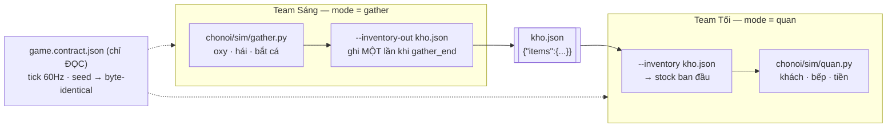

# Hợp đồng tích hợp — ĐÓNG BĂNG v1.0 (Team Sáng ↔ Team Tối)

> **Trạng thái:** đã chốt tại kickoff. Hai team làm **song song** và chỉ gặp nhau ở **file kho** + các bất biến
> chung dưới đây. Đổi hợp đồng ⇒ báo cả nhóm + mở ADR (`docs/adr/`) + cập nhật **cả hai** phía và test (xem §7).

Nguyên tắc gốc: **hai team không gọi hàm của nhau**. Ranh giới duy nhất là **file kho** (sáng ghi → tối đọc)
và **định dạng snapshot/JSONL/exit code** dùng chung. Vì vậy mỗi team test độc lập được.



---

## 1. File kho — bàn giao Sáng → Tối  (bắt buộc khớp)

**Định dạng (đóng băng):**

```json
{"items":{"bong_sung":2,"ca_loc":1}}
```

- Chỉ **một khóa gốc** `items`; giá trị là object `{<kind>: <số nguyên ≥ 0>}`.
- `kind` hợp lệ P1: `ca_loc`, `ca_linh`, `bong_dien_dien`, `bong_sung` (tập `KINDS_P1`).
- **Bỏ mục = 0** khi ghi. Ghi **nguyên tử** (file tạm + `os.replace`), **một lần duy nhất** khi có `gather_end`.
- **Sáng (writer)** — Team sáng đảm bảo:
  - Ghi khi `gather_end` với `reason ∈ {docked, fainted, time}`.
  - **KHÔNG** ghi khi kết thúc do `tick_limit` (chỉ chạy hết `--ticks`).
  - `fainted` ⇒ kho **rỗng** (`{"items":{}}`).
  - Ghi vào path của `--inventory-out` (chỉ dùng khi `--mode gather`).
- **Tối (reader)** — Team tối đảm bảo:
  - Nạp qua `--inventory <path>` (chỉ dùng khi `--mode quan`) → trở thành `stock` ban đầu.
  - `stock` ban đầu = `items` (giữ nguyên số lượng).
  - **Fallback:** không có `--inventory` thì dùng `scenario.stock`.
  - **Mâu thuẫn:** có **cả** `--inventory` **và** `scenario.stock` ⇒ **thoát 2**.
  - Sai schema (thiếu `items`, có khóa lạ), `kind` lạ, số âm, số không phải `int` ⇒ **thoát 2**.
  - **Trần giỏ (`hold_capacity`) KHÔNG áp lên kho quán** — kho lớn hơn sức chứa giỏ vẫn hợp lệ.
  - **Quán độc lập** (thiếu cả `--inventory` và `scenario.quan.stock`) ⇒ kho **rỗng**; `money`/`earned` đầu lượt = 0; uy tín theo tuning (trừ khi scenario khai).
- Mẫu hợp lệ: [`inventory.sample.json`](inventory.sample.json).

**Ngoài phạm vi P1 (ghi nhận để không giẫm chân):** id nguyên liệu **mới** do sáng tạo (phase sau) phải khai
báo **trước** cho cả hai team + thêm vào `KINDS`/`game.contract.json`; không tự thêm lẻ ở một phía.

---

## 2. Giao diện sim ↔ UI (dùng chung)

- **UI chỉ ĐỌC snapshot** và **bỏ qua trường chưa có** ⇒ team này viết thêm trường không làm vỡ UI team kia.
- **Lệnh UI gửi vào sim** (qua `chonoi.live`, POST `/input`):
  `{"move":[a,b], "interact":bool, "catch":bool}`, với `a,b ∈ [-1,1]` (đã chuẩn hóa, đi chéo không nhanh hơn).
- **Headless** nhận cùng thông tin qua file `--inputs`: `{"frames":[{"tick":int,"move":[a,b],"interact":bool,"catch":bool}]}`.
  - `move` kế thừa giá trị cũ khi vắng frame; nút chỉ kích khi **cạnh lên** (false→true).
  - Thành phần thứ hai dương = **xuống** (gather `[x,d]`) · **về bắc** (quan `[x,z]`).
  - `interact` = cập bến/hái (gather) · nấu/bưng/phục vụ (quan); `catch` = bắt cá (gather). Hành động đúng kiểu nhưng **sai pha bị bỏ qua**.
  - Nút hợp lệ **v1.0** = `interact`, `catch` (nút khác như `jump`,`attack` ⇒ **thoát 2**).
- **Vỏ snapshot dùng chung (cả 2 mode):**
  `type,"tick","sim_tick","mode","phase","phase_tick","state","time_left_ticks","money","earned","reputation","score"`,
  trong đó `score = earned + 100 × floor(reputation)`.
- **Trường riêng từng mode** (§3). Mọi số thực **làm tròn 3 chữ số** khi xuất.

---

## 3. Trường snapshot theo mode

**gather** — `player{pos, vel, heading_deg, oxygen_ticks, oxygen_max_ticks, hp, hp_max, zero_oxy_ticks, catch_cd_ticks, at_surface}`
· `hold` · `hold_count` · `hold_capacity` · `nodes[]{id,pos,kind,ready,regrow_ticks}` (`ready = regrow_ticks == 0`) · `fish[]{id,pos,kind,heading_deg}`.
*(starter còn xuất `invuln_ticks`; PRD §D không yêu cầu.)*

**quan** — `player{pos, vel}` · `stock{kind:int}` · `hand` · `stoves[]{id,pos,state,dish,cook_ticks_left,ready_ticks}`
· `tables[]{id,pos,customer_id}` (`customer_id` null khi trống) · `customers[]{id,table_id,dish_id,order_tick,state,patience_ticks_left,eat_ticks_left,order_status,reserved,base_price,tip}`.
**Chỉ liệt kê khách còn ngồi.**

---

## 4. Danh sách sự kiện (đóng băng tên + khóa `data`)

Dòng event: `{"type":"event","tick":k,"phase":...,"name":...,"data":{...}}`. Ai phát do sim tương ứng; ai nghe = UI/HUD + test.

| Mode | `name` | `data` |
|---|---|---|
| gather | `dive` / `surface` | `pos` (sau di chuyển; **chỉ khi đổi phía** biên mặt nước) |
| gather | `oxygen_empty` | `oxygen_ticks:0` (khi **vừa chạm 0**) |
| gather | `choke` | `hp` (sau trừ) |
| gather | `faint` | `cause:"choke"`, `lost`, `hp:0` |
| gather | `gather` | `node_id`, `kind`, `amount` |
| gather | `node_regrown` | `node_id` |
| gather | `hold_full` | `action`(`gather`/`catch`), `node_id` **hoặc** `fish_id`, `required`, `free` |
| gather | `fish_caught` | `fish_id`, `kind`, `yield` (một event mỗi đàn lấy đủ `yield`) |
| gather | `gather_end` | `reason`(`time`/`docked`/`fainted`), `inventory` (object theo §1) |
| quan | `customer_arrived` | `order_id`, `table_id`, `dish_id` |
| quan | `no_dish` | `{}` (khi có bàn mà thiếu món) |
| quan | `cook_started` | `stove_id`, `order_id`, `dish_id`, `items`, `base_price` |
| quan | `dish_ready` | `stove_id`, `order_id`, `dish_id` |
| quan | `dish_picked` | `stove_id`, `order_id`, `dish_id` |
| quan | `served` | `order_id`, `table_id`, `dish_id`, `patience_ticks_left`, `base_price`, `tip` |
| quan | `paid` | `order_id`, `table_id`, `base_price`, `tip`, `amount`, `reason`(`finished_eating`/`closing`) |
| quan | `customer_left` | `order_id`, `table_id`, `reason`(`patience`/`closing`), `reputation` |
| quan | `quan_end` | `reason:"time"`, `money`, `earned`, `shift_earned`, `reputation` |

Ghi chú: mọi event `cook_*`/`dish_*` đều có `stove_id`,`order_id`,`dish_id`. `items` và `lost` trong event là **mảng kind**;
`lost` theo thứ tự bỏ, **LIFO** (nhặt sau bỏ trước). Không có `customer_id` — dùng `order_id` (= id khách).

---

## 5. Bất biến chung (2 team phải giữ)

- **Tick 60Hz**; `--seed` cố định ⇒ JSONL **giống từng byte**.
- **Số liệu chỉ đọc từ `game.contract.json`** — không hard-code (sáng đọc `tuning.gather`/`tuning.menu`; tối đọc `tuning.quan`/`tuning.menu`).
- **Ngẫu nhiên chỉ qua `Streams(seed).get("<tên-luồng>")`**; **đặt tên luồng riêng** để không lệch chuỗi của nhau
  (gợi ý: sáng `fish_spawn`/`fish_move`; tối `customer_spawn`). **Không** `random` toàn cục, **không** đồng hồ hệ thống.
- **ID** cấp bằng `IdAllocator`, sắp bằng `ids.sort_by_id` (F2 < F10).
- **Mã thoát:** `0` OK · `2` đầu vào sai/mâu thuẫn (**trước** khi ghi output) · `1` lỗi chạy/ghi.
- **JSONL:** snapshot tick 0 đầu tiên; dòng `end` cuối cùng (đúng 1); mỗi tick ≤ 1 snapshot.
- **Dòng `end`:** `type:"end","ticks","sim_tick","mode","state","reason","money","earned","reputation","score"`; `reason` = `time`/`docked`/`fainted` (gather) · `time` (quan) · `tick_limit` khi gameplay **chưa** xong. Kết thúc đúng bước cuối được cấp ⇒ ưu tiên **lý do gameplay**.
- **Sắp xếp:** mảng thực thể theo id; `hold` theo thứ tự nhặt; `cook_started.items` theo kind. Tọa độ xuất **3 chữ số thập phân**.
- **Tất định:** cùng bản chạy/máy/seed/tham số/inputs ⇒ JSONL **và file kho** giống **từng byte**; duyệt ứng viên theo thứ tự cố định, id món theo mã Unicode.

---

## 6. Ranh giới file — ai sở hữu gì (tránh conflict)

| Vùng | Team Sáng (own) | Team Tối (own) | Dùng chung (chỉ 1 người sửa) |
|---|---|---|---|
| Luật | `chonoi/sim/gather.py` | `chonoi/sim/quan.py` | `chonoi/sim/ramp.py` (Hải) |
| UI | `client/ui` phần gather | `client/ui` phần quan | `chonoi/web/index.html` (1 người) |
| Test | `tests/test_*gather*` | `tests/test_*quan*` | `tests/test_smoke_p1.py` (đóng băng) |
| Tài liệu | `docs/verification/phase-1.md` | `docs/verification/phase-2.md` | `AGENTS.md` (Sơn), `TEAM.md` (Hải), `CREDITS.md` (Tùng) |

- **Không sửa `game.contract.json`, `docs/contracts/`, `chonoi/{runner,inputs,scenario,inventory,ids,rng,jsonl,contract}.py`** nếu chưa báo — đổi khối nào ảnh hưởng cả hai team.
- Mỗi người làm **nhánh ngắn** `feat/<phase>-<viec>` → PR vào `main`; **chạy test trước khi push**.

---

## 7. Đổi hợp đồng sau này (change request)

1. Báo trong kênh nhóm + ghi **ADR** (`docs/adr/`) kèm **bảng tác động** (module/file/test bị ảnh hưởng ở **cả hai** team).
2. Cập nhật file này (`docs/contracts/`) — đây là nguồn sự thật của ranh giới.
3. Cập nhật **cả phía ghi và phía đọc** + thêm test chứng minh; chạy lại `test_smoke_p1.py`.
4. Integrator xác nhận hai team đã khớp trước khi gắn tag phase kế tiếp.

## 8. Biên bản chốt hợp đồng (điền khi kickoff)

- [ ] Cả 6 thành viên đã đọc file này và đồng ý.
- [ ] Team Sáng xác nhận §1 (schema kho + thời điểm ghi) — người: ______
- [ ] Team Tối xác nhận §1 (nạp kho + fallback scenario.stock) — người: ______
- [ ] `inventory.sample.json` là mẫu hợp lệ hai bên cùng dùng.
- [ ] Chốt ngày giờ: ______

## 9. Checklist tuân thủ hợp đồng (mỗi phần)

**§1 File kho (Sáng ghi ↔ Tối đọc)**
- [ ] Ghi: đúng khóa gốc `items`; bỏ mục 0; ghi nguyên tử; **một lần** khi `gather_end`.
- [ ] Ghi: chỉ khi `reason ∈ {docked, fainted, time}`; **không** ghi khi `tick_limit`.
- [ ] Đọc: `--inventory` → `stock`; fallback `scenario.stock`; **cả hai ⇒ thoát 2**.
- [ ] Lỗi: thiếu `items` / khóa lạ / `kind` lạ / số âm / không phải `int` ⇒ **thoát 2**.
- [ ] Khớp `inventory.sample.json` và dùng chung `KINDS_P1`.

**§2 Giao diện sim ↔ UI**
- [ ] UI chỉ đọc snapshot, bỏ qua trường chưa có (team kia thêm trường không vỡ UI).
- [ ] Lệnh chỉ gồm `move∈[-1,1]^2`, `interact`, `catch`; nút khác ⇒ thoát 2.
- [ ] Vỏ snapshot chung đúng khóa; `score = earned + 100×floor(reputation)`.

**§3 Trường snapshot theo mode**
- [ ] gather có đủ `player{...}` + `hold*` + `nodes[]` + `fish[]`.
- [ ] quan có đủ `player` + `stock` + `hand` + `stoves[]` + `tables[]` + `customers[]`.
- [ ] Số thực làm tròn 3 chữ số khi xuất.

**§4 Sự kiện**
- [ ] Tên sự kiện + khóa `data` đúng bảng; không tự đổi tên.
- [ ] `gather_end.inventory` khớp file kho đã ghi; `quan_end` đủ `money/earned/shift_earned/reputation`.

**§5 Bất biến chung**
- [ ] Cùng seed ⇒ JSONL **giống từng byte** (kiểm bằng diff 2 lần chạy).
- [ ] Số liệu chỉ đọc từ `game.contract.json` (không hard-code).
- [ ] RNG chỉ qua `Streams`, **tên luồng riêng** từng team; không đồng hồ hệ thống.
- [ ] ID qua `IdAllocator`/`sort_by_id`; exit code `0/1/2` đúng.

**§6 Ranh giới file**
- [ ] Mỗi team chỉ sửa vùng của mình; file dùng chung do người được giao sửa.
- [ ] Không sửa `game.contract.json` / `docs/contracts/` / file khung khi chưa báo.

**§7 Đổi hợp đồng**
- [ ] Có ADR + bảng tác động; đã cập nhật **cả** phía ghi và đọc + test; Integrator xác nhận.
